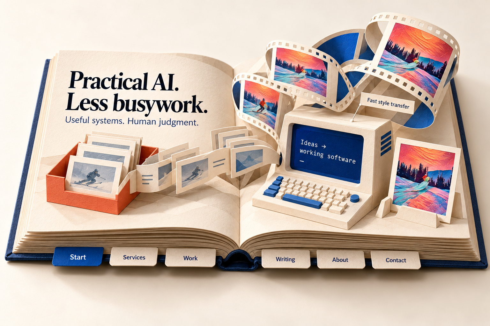
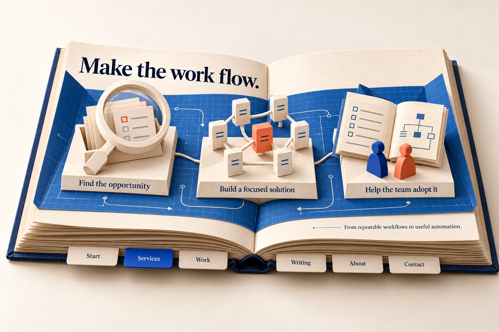
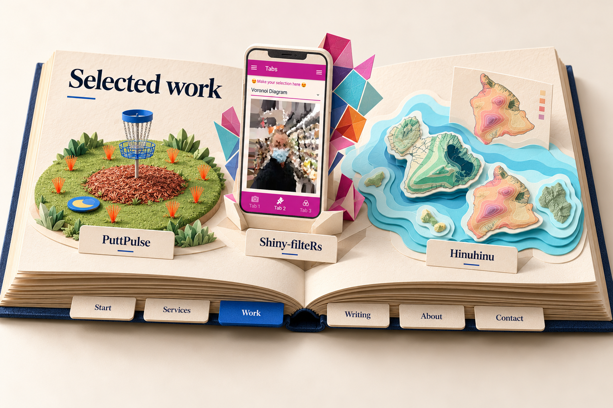
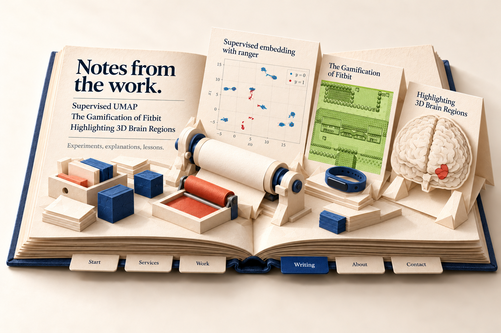
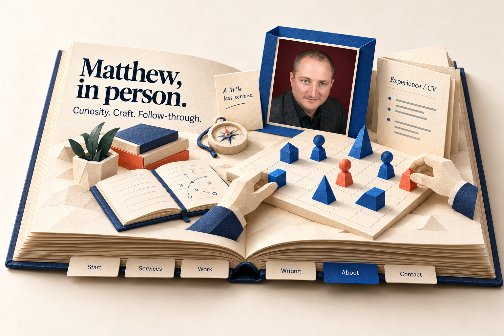
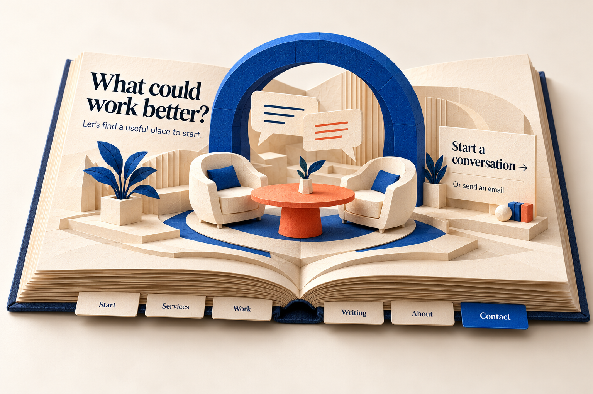

# Six revised pop-up book chapters

Round 2, 22 October 2026. Created with built-in Image Gen after Matthew requested physical chapter tabs, existing work instead of an invented enquiry demo, and a distinct design for every chapter. These six images supersede the earlier chapter scenes for current review. The first editorial-workshop direction remains selected; individual chapter approval is pending.

Every spread shows six lower-edge paper tabs: **Start, Services, Work, Writing, About, Contact**. The active tab is cobalt. These will be real page-turn controls alongside the site's top navigation, with equivalent keyboard-accessible HTML controls. No sidebar is proposed.

## Start — terminal theatre

A folded computer and sculptural film ribbon draw on the existing **TensorFlow CNN for Fast Style Transfer** article and touring footage. The generated grayscale input frames are illustrative, not recovered before/after evidence. Use actual source captures and animated media when building. The terminal folds open, the ribbon advances and selecting a frame leads to the article. The homepage headline remains readable HTML.

[Exact prompt](round-2/01-start-prompt.txt).

## Services — workflow drafting table

A cobalt engineering folio and three connected models explain finding an opportunity, building a focused solution and helping a team adopt it. The vocabulary is grounded in the existing **Drake** and **.Rprofile** articles. This is a service metaphor, not a client case study or recovered graph. Unfold the board, reveal paths and lift the selected model; open service details in HTML.

[Exact prompt](round-2/02-services-prompt.txt).

## Work — three different project exhibits

- **PuttPulse:** putting basket, raised wood-chip mulch, wider grass circle and plastic marking whiskers. No tee pad.
- **Shiny-filteRs:** actual Voronoi portrait and magenta/cyan interface inform a phone and polygon sculpture. Use original image textures in implementation, not generated UI text.
- **Hinuhinu:** existing Hawaiian moisture/solar/depth maps inform layered cartography. The concept rearranges maps; it is not a geographically surveyed model or application screenshot.

Each project has a separate motion treatment: disc flight, articulated polygon panels and layered-map camera movement. Each opens its evidence-backed case study. The fictional **Enquiry workflow is removed** from featured work and launch scope.

[Exact prompt](round-2/03-work-prompt.txt).

## Writing — editorial print studio

A proofing roller and folding exhibits showcase **Supervised UMAP**, **The Gamification of Fitbit**, and **Highlighting 3D Brain Regions**. Matthew requested the latter two in place of Drake and .Rprofile. Fitbit uses the existing green pixel-art project image; the brain exhibit uses the existing rendering with a small highlighted red region. Both are grounded in the actual project pages rather than invented demos. The UMAP reference remains the recovered original slide plot.

[Exact revised prompt](round-2/04-writing-v2-prompt.txt). The [previous Writing concept](round-2/04-writing.png) is retained as history; its Drake/.Rprofile selection is superseded for this spread.

Animate the printer, paper folds and Fitbit display reveal. For brain-region selection/rotation, recover and verify the original mesh/atlas before offering anatomical interaction. Until then, use the faithful original brain image as a texture with a simple reveal; generated paper anatomy is art direction, not a validated model. Preserve the UMAP plot's 2D meaning. Selection leads to readable source-backed content with original titles and dates; the two legacy project summaries still require full article recovery.

**Article navigation is required:** clicking/tapping the UMAP sheet, Fitbit exhibit or brain exhibit opens that specific article directly. Make each complete exhibit and its title a generous target; provide a matching real HTML anchor for keyboard, touch and no-WebGL use. Any brief camera transition must finish by navigating, rather than stopping at a visual zoom or intermediate project card. Reduced motion navigates immediately. Browser Back restores the Writing chapter. Brain rotation/region controls must not intercept the article link; offer a separate explicit interaction control if needed.

The existing sources are [UMAP](https://moldach.github.io/post/supervised-umap/), [the Fitbit article linked from its legacy project](https://moldach.github.io/fitbit-project/) and [How to Highlight 3D Brain Regions](https://towardsdatascience.com/how-to-highlight-3d-brain-regions-2e6c15a35574). Recover full content and verify destinations before launch; do not substitute the short legacy project summaries for the articles. Internal reading routes can replace external links when the full articles are available. These controls remain implementation requirements, not working links embedded in the concept image.

## About — personal strategy table

Matthew's supplied likeness, an Experience/CV folio and an unbranded strategy board replace another mountain-and-disc-golf scene. Small game-piece movements and an opening notebook provide motion. Use the original photo texture in implementation. No invented employer history is implied. The shared footer portrait still opens the **required draggable-face dialog**; this framed image does not replace it.

[Exact prompt](round-2/05-about-prompt.txt).

## Contact — conversation room

Two chairs, a coral table and a cobalt arch create a quieter final chapter. Chairs unfold and speech panels rise; activating the invitation opens an accessible HTML enquiry form. Direct email remains available. This is a contact entry point, not an enquiry-processing product.

[Exact prompt](round-2/06-contact-prompt.txt).

## Source media and WebGL construction

The [asset and motion map](../asset-motion-map.md) records existing media, provenance limits and separate animation treatments. Videos and working WebGL scenes have **not** been created in this concept pass.

- Build cover, leaves, tabs, pop-outs and selectable objects as actual geometry. Images are targets and possible loading posters; camera movement over a single flat spread does not fulfill the book requirement.
- Reuse the book rig and light, not scenery. Each chapter has its own scene group, fold axes and semantic hotspots.
- A tab folds current pop-outs toward their leaf, turns the required leaves and raises the destination scene. Keep tabs, URL/history, Previous/Next and direct navigation synchronized. Prototype interrupted/reversed turns first.
- Rendered models establish art direction, not validated paper engineering. Simplify terminal, phone, roller, chairs and arch into articulated card surfaces; test intersections and collapse in the two-chapter prototype.
- Raycast meshes to meaningful links/buttons with visible keyboard equivalents. Browser Back, direct routes, readable content and contact access remain available.
- Mobile gets a simpler camera and normal scrolling. Reduced motion skips cinematic transitions; graphics failure preserves HTML. Browser/device performance and accessibility remain unverified.

## Earlier concepts and putting reference

Earlier chapter v1 images and Work/About v2 remain design history. Their invented enquiry exhibits and repeating mountains are superseded. The desktop selected-v4 image establishes layout history only; its old featured-project content must not be implemented.

The [putting reference study](putting-reference-study.md) and [putting-area illustration](putting-area-reference-v1.png) retain the researched basket/mulch/whisker anatomy. Raster marker spacing is illustrative, not measured geometry.
