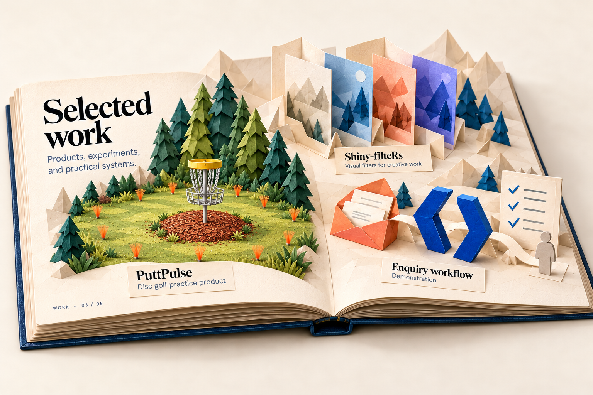
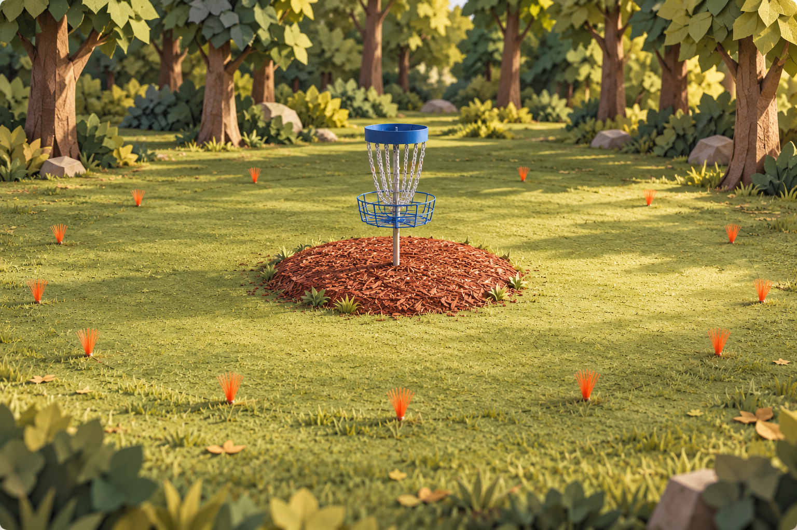

# Pop-up book chapter concepts

Created 2026-10-22 with built-in Image Gen. Matthew selected the first editorial-workshop direction and requested an image for each chapter to iterate before WebGL implementation. These are six complementary spreads, not competing whole-site options. Exact prompts are stored beside each image.

## Review status

The art direction is selected; individual chapter scenes are drafts. Work and About v2 now apply the requested putting-area correction; individual chapter review remains pending. A rendered image does not establish working geometry, page turns, camera interaction or mesh deformation. No replacement website UI has been scaffolded.

## Start · 01

An inbox, code gateway and human-review station connect across the book. Candidate interactions: inbox opens Services, code gateway opens Work, personal hotspot opens About. The opening folds raise in sequence; the code gateway can receive the first camera push-in. Keep the selected homepage's separate top navigation and readable copy.

## Services · 02

Three substantial objects represent opportunity assessment, focused implementation and team adoption. Clicking a station reveals its service details in accessible HTML; the human-review gate remains part of the story. The illustrated conveyor is conceptual: its actual fold mechanism must be simplified and validated in the prototype. Final labels use exact reviewed text rather than generated raster lettering.

## Work · 03

PuttPulse, Shiny-filteRs and the labeled enquiry demonstration are separate selectable exhibits. Each opens its evidence-backed case study after a restrained camera move. PuttPulse now uses a putting-practice scene with the required basket, raised mulch bed and ground-marker circle. The [initial fairway version](03-work-v1.png) is superseded. The image is a conceptual project illustration, not a screenshot of shipped functionality.

## Writing · 04

A paper library and reading desk provide selected article objects and a route to the complete archive. Selecting a folio brings it forward and opens readable HTML writing. Display actual recovered titles/dates in the implementation; generic notebook labels in the image are editorial placeholders, not claims of published articles.

## About · 05

The supplied likeness and CV folio lead to About/Experience. Mountains, a workbench and strategy motifs add personal context. The disc-golf miniature now uses the same putting-area anatomy as Work. The [initial miniature](05-about-v1.png) is superseded. The mandatory face-deformation dialog remains triggered by the footer portrait; a framed photo in this spread does not replace that feature.

## Contact · 06

An envelope is the main hotspot for a short accessible contact form; direct email is the fallback. The scene can lean toward the envelope before presenting the HTML form. No form, text input or submission status should exist only as canvas pixels.

## Required disc-golf correction

Matthew's latest instruction supersedes all earlier fairway imagery: one putting basket raised on a small bed of wood-chip mulch, with small plastic ground markers defining the surrounding circle. No tee pad or driving-fairway composition. See [reference study](putting-reference-study.md) for internet sources and exact visual requirements.

This original stylized illustration guides the updated homepage thumbnail and Work/About scenes. Marker placement in this concept is illustrative; final 3D geometry must use consistent chosen scale rather than treating raster spacing as a measured course survey.

## WebGL construction and interaction contract

- Build the book, leaves, pop-out layers and selectable objects as real geometry. Images are concept targets and optional loading/reduced-capability posters; camera motion over a flat chapter picture does not fulfill the brief.
- Reuse one cover/spine/leaf rig. Give each chapter its own pop-out group, fold axes and hotspot bounds. Fold standing parts toward their parent leaf before turning it; reveal the next chapter after the page crosses the spine.
- Prototype Start and Services first. Validate paper intersections, folds, click targets, camera framing and interrupted/reversed turns before expanding all six detailed scenes.
- Raycast selectable mesh groups to semantic destinations. Match each hotspot with a real HTML link/button, visible focus and keyboard access. Zoom remains bounded with an obvious return path; ordinary navigation and browser history remain usable.
- Use a simpler mobile camera/scene and normal scrolling. Reduced motion skips cinematic camera/page movement. Graphics failure retains readable HTML and contact access. Validate performance on real devices before finalizing mesh density and lighting.

Chapter artwork and exact interaction behavior remain open for Matthew's iteration. These records do not mark the WebGL implementation complete.

