> **Anyone can look for fashion in a boutique or history in a museum. The creative explorer looks for history in a hardware store and fashion in an airport — Robert Wieder**

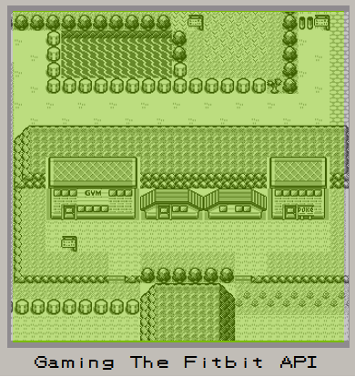


\# Load the environment

```
# Downloading The Whole Internet

# install needs to load/download all CRAN packages
if (!require("needs")) {
  install.packages("needs", dependencies = TRUE)
  library(needs)
}

# Install/Load Libraries from CRAN
needs(tidyverse,
      magrittr,
      ggridges,
      httr,
      ggExtra,
      ggcorrplot,
      kableExtra,
      corrplot,
      cowplot
)

# Download packages from Github
if (!require("gganimate")) {
  devtools::install_github("thomasp85/gganimate")
  library(gganimate)
}

if (!require("Rokemon")) {
  devtools::install_github("schochastics/Rokemon")
  library(Rokemon)
}

if (!require("fitbitr")) {
  devtools::install_github("jhudsl/fitbitr")
  library(fitbitr)
}
```

```
# Removing pen from pineapple


# Code adapted from https://coolbutuseless.github.io/2018/08/13/gganimate-with-sprites/
# Image Source: https://www.spriters-resource.com/game_boy_advance/kirbynim/sheet/15585/
#
### load png image
sprite_sheet <- png::readPNG("kirby.png")

Nframes       <- 10      # number of frames to extract
width         <- 28      # width of a frame
sprite_frames <- list()  # storage for the extracted frames

# Not equal sized frames in the sprite sheet. Need to compensate for each frame
offset <- c(3, 4, 6, 7, 7, 9, 10, 11, 12, 13)

# Manually extract each frame
for (i in seq(Nframes)) {
  sprite_frames[[i]] <- sprite_sheet[27:54, (width*(i-1)) + (1:width) + offset[i], 1:3]
}

# Function to convert a sprite frame to a data.frame
# and remove any background pixels i.e. #00DBFF
sprite_frame_to_df <- function(frame) {
  plot_df <- data_frame(
    fill  = as.vector(as.raster(frame)),
    x = rep(1:width, width),
    y = rep(width:1, each=width)
  ) %>%
    filter(fill != '#00DBFF')
}

sprite_dfs <- sprite_frames %>%
  map(sprite_frame_to_df) %>%
  imap(~mutate(.x, idx=.y))

fill_manual_values <- unique(sprite_dfs[[1]]$fill)
fill_manual_values <- setNames(fill_manual_values, fill_manual_values)

mega_df <- dplyr::bind_rows(sprite_dfs)

p <- ggplot(mega_df, aes(x, y, fill=fill)) +
  geom_tile(width=0.9, height=0.9) +
  coord_equal(xlim=c(1, width), ylim=c(1, width)) +
  scale_fill_manual(values = fill_manual_values) +
  theme_gba() +
        xlab("") +
        ylab("") +
  theme(legend.position = 'none', axis.text=element_blank(), axis.ticks = element_blank())

panim <- p +
  transition_manual(idx, seq_along(sprite_frames)) +
  labs(title = "gganimate Kirby")

gganimate::animate(panim, fps=35, width=400, height=400)
```

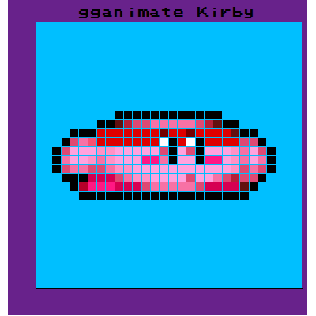

## Project Inspiration

* * *

You may, or may not, have heard of the term `gamification` but chances are you’ve experienced it.

`Gamification` is the application of game-design elements, and game principles, in non-game contexts. The idea is, if you use elements of games, like linking rules and rewards into a feedback system, you can make (almost) any activity motivating and fun.

`Gamification` is the concept behind **eLearning**. In elementary school I remember all the students wanted to play [The Oregon Trail](https://classicreload.com/oregon-trail.html) in computer class. I also remember another game where you had to solve math problems before something hit the floor. Okay, maybe it wasn’t the most thrilling introduction to `gamification` but I remember it nonetheless.

At some point in my career, I got tired of using `nano` and decided to I wanted to try to learn `Vim`.

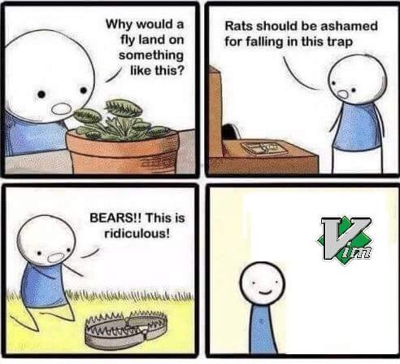

It was then that I discovered two very enjoyable examples of `gamification`:

*   [`Vim Adventures`](https://vim-adventures.com/) is kind of like `Zelda` for `Gameboy` where you have to move through the environment and solve riddles - except with `Vim` commands! You can [watch it being played on Twitch here](https://www.youtube.com/watch?v=zGk_ipjk9uw).

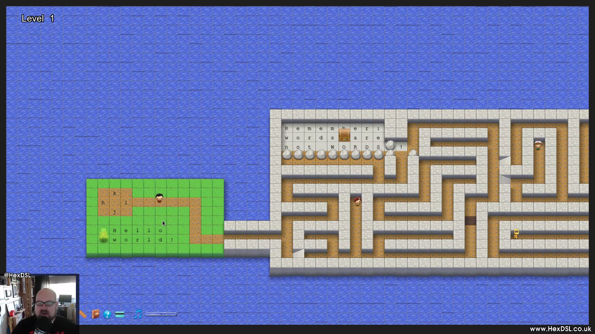


*   [`shortcutFoo`](https://www.shortcutfoo.com/) teaches you shortcuts for `Vim`, `Emacs`, `Command Line`, `Regex` _etc._ via **interval training**, which is essentially spaced repetition. This helps you memorize shortcuts more efficiently.

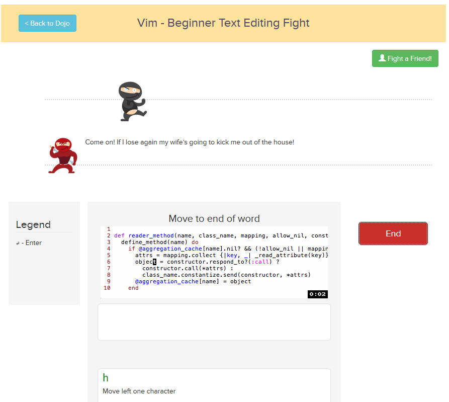

Today, I enjoy eLearning-`gamification` on platforms like [DuoLingo](https://www.google.com/url?sa=t&rct=j&q=&esrc=s&source=web&cd=1&cad=rja&uact=8&ved=2ahUKEwiQm7ib677eAhUovlkKHRr-BygQFjAAegQIAhAC&url=https%3A%2F%2Fwww.duolingo.com%2F&usg=AOvVaw0GVHP2wYuntJMUTG1EDY5y), and [DataCamp](https://www.google.com/url?sa=t&rct=j&q=&esrc=s&source=web&cd=1&cad=rja&uact=8&ved=2ahUKEwiQm7ib677eAhUovlkKHRr-BygQFjAAegQIAhAC&url=https%3A%2F%2Fwww.duolingo.com%2F&usg=AOvVaw0GVHP2wYuntJMUTG1EDY5y).

I’ve also recently started to participate in a Kaggle competition, “[PUBG Finish Placement Prediction](https://www.kaggle.com/c/pubg-finish-placement-prediction)”. Kaggle is a Google owned hangout for data science enthusiasts where they can use machine learning to solve predictive analytics problems for cash and clout. Similar to chess there are so-called **Kaggle Grandmasters**.


### The Quest

* * *

Our laboratory studies perinatal influences on the biological embedding of early adversity of mental health outcomes. We combine genetic, epigenetic and epidemiological approaches to identify pregnant women who’s offspring may potentially be at risk for adverse mental health outcomes.

> My supervisor approached me with a challenge; how feasible would it be to access biometric data from 200 Fitbits?

**So I bought myself a Fitbit Charge2 fitness tracker and hit the gym!**

At some point I think we both realized that this project was going to be a big undertaking. Perhaps `R` isn’t really intended to do large scale real-time data management from API services. It’s great for static files, or static endpoints, but if you’re working with multiple participants a dedicated solution like [Fitabase](https://www.fitabase.com/) may work the best - or so they claim.

Nonetheless, I wanted to try out a bunch of cool new things in `R` like making a personal website using `blogdown`, using `gganimate` with `Rokemon`, accessing the fitbit API with `httr` as well as adding a background image with some custom CSS/HTML. Is there possibly a better way to possibly `gamify` my leaRning curve - I think not.


**The following was my attempt at e-learning `gamification` for `R`.**


I used the [`blogdown`](https://bookdown.org/yihui/blogdown/) package to allow me to write blog posts as R Markdown documents, knitting everything to a nice neat static website that I can push online. It was a nice opportunity to learn a bit about pandoc, Hugo, CSS/HTML lurking beneath the server side code. I decided to go with the [Academic theme](https://themes.gohugo.io/academic/) for [Hugo](https://gohugo.io/), pull in as much data as I could from the Fitbit API, clean it up, and then perform some exploratory data analysis. In the process, I generated some cool animated sprites and use video game inspired visualizations.

### Setting up a Fitbit Developer Account

* * *

Fitbit uses **[OAuth 2.0](https://dev.fitbit.com/build/reference/web-api/oauth2/) Access** Token for making HTTP request to the Fitbit API. You need to set up an account to use the API and include your token in `R`. Instead of reading the [FITBIT DEV HELP](https://dev.fitbit.com/build/reference/web-api/basics/#app-registration) section I would direct the reader to better more-concise instructions [here](https://obrl-soil.github.io/fitbit-api-r/).

Now that you have an account we’re ready to do stuff in `R`.

Set your token up:

```
# You Found A Secret Area!
token = "yourToken"
```


## Using The `fitbitr` Package

* * *

I had never made an `HTTP` request before and although the process is officially documented [here](\(https://dev.fitbit.com/build/reference/web-api/oauth2/\)) it can be a _tad_ overwhelming. Therefore, I initially resorted to using an `R` package built to access the R API, under-the-hood, called `fitbitr`.

Unfortunately this would limit me to only accessing some basic user information, `heart rate` and `step count` data.


### Getting Basic User Info

* * *

The first function in this package sends a `GET` request to the `Get Profile` [resource URL](https://dev.fitbit.com/build/reference/web-api/user/#get-profile).

```
# Extracting Resources

# Get userInfo
user_info <- fitbitr::getUserInfo(token)
```

```
# Hailing a Chocobo!

# What is my stride length in meters?
strideLengthWalking <- user_info$strideLengthWalking
```

My stride length is 68.5.

_Stride length is measured from heel to heel and determines how far you walk with each step. On average, a man’s walking stride length is 2.5 feet, or 30 inches, while a woman’s average stride length is 2.2 feet, or 26.4 inches, according to this [report](https://livehealthy.chron.com/average-walking-stride-length-7494.html)._

```
# Hitting 80 MPH

# What is my running stride length
strideLengthRunning <- user_info$strideLengthRunning
```

My running stride length is 105.5.

_The Fitbit uses your `sex` and `height` by default to gauge your stride length which could potentially be inaccurate._

```
# Looking for the fourth chaos emerald

# What is my average daily steps?
averageDailySteps <- user_info$averageDailySteps
```

My average daily steps is 14214.

Considering that the daily recommended steps is 10,000 I’d say that’s acceptable. That being said, there’s always room for improvement.

### Accessing Heart Rate And Footsteps With The `fitbitr` Pacakge

I’m going to grab a week’s worth of data for a very preliminary EDA.

```
# Smashing buttons

days <- c("Sunday", "Monday", "Tuesday", "Wednesday", "Thursday", "Friday", "Saturday")

monday_heart <- getTimeSeries(token, type = "heart", activityDetail = "1min", date = "2018-08-20", startTime = "00:00", endTime = "23:59")
monday_heart %<>% mutate(date = "2018-08-20")
monday_steps <- getTimeSeries(token, type = "steps", activityDetail = "1min", date = "2018-08-20")
monday_steps %<>% mutate(date = "2018-08-20")
monday <- monday_heart %>% full_join(monday_steps)
monday %<>% mutate(week_date = "Monday")
monday %<>% mutate(day_of_week = "1")

tuesday_heart <- getTimeSeries(token, type = "heart", activityDetail = "1min", date = "2018-08-21")
tuesday_heart %<>% mutate(date = "2018-08-21")
tuesday_steps <- getTimeSeries(token, type = "steps", activityDetail = "1min", date = "2018-08-21")
tuesday_steps %<>% mutate(date = "2018-08-21")
tuesday <- tuesday_heart %>% full_join(tuesday_steps)
tuesday %<>% mutate(week_date = "Tuesday")
tuesday %<>% mutate(day_of_week = "2")

wednesday_heart <- getTimeSeries(token, type = "heart", activityDetail = "1min", date = "2018-08-22")
wednesday_heart %<>% mutate(date = "2018-08-22")
wednesday_steps <- getTimeSeries(token, type = "steps", activityDetail = "1min", date = "2018-08-22")
wednesday_steps %<>% mutate(date = "2018-08-22")
wednesday <- wednesday_heart %>% full_join(wednesday_steps)
wednesday %<>% mutate(week_date = "Wednesday")
wednesday %<>% mutate(day_of_week = "3")

thursday_heart <- getTimeSeries(token, type = "heart", activityDetail = "1min", date = "2018-08-23")
thursday_heart %<>% mutate(date = "2018-08-23")
thursday_steps <- getTimeSeries(token, type = "steps", activityDetail = "1min", date = "2018-08-23")
thursday_steps %<>% mutate(date = "2018-08-23")
thursday <- thursday_heart %>% full_join(thursday_steps)
thursday %<>% mutate(week_date = "Thursday")
thursday %<>% mutate(day_of_week = "4")

friday_heart <- getTimeSeries(token, type = "heart", activityDetail = "1min", date = "2018-08-24")
friday_heart %<>% mutate(date = "2018-08-24")
friday_steps <- getTimeSeries(token, type = "steps", activityDetail = "1min", date = "2018-08-24")
friday_steps %<>% mutate(date = "2018-08-24")
friday <- friday_heart %>% full_join(friday_steps)
friday %<>% mutate(week_date = "Friday")
friday %<>% mutate(day_of_week = "5")

saturday_heart <- getTimeSeries(token, type = "heart", activityDetail = "1min", date = "2018-08-24")
saturday_heart %<>% mutate(date = "2018-08-24")
saturday_steps <- getTimeSeries(token, type = "steps", activityDetail = "1min", date = "2018-08-24")
saturday_steps %<>% mutate(date = "2018-08-24")
saturday <- saturday_heart %>% full_join(saturday_steps)
saturday %<>% mutate(week_date = "Saturday")
saturday %<>% mutate(day_of_week = "6")

week <- monday %>% bind_rows(tuesday) %>% bind_rows(wednesday) %>% bind_rows(thursday) %>% bind_rows(friday) %>% bind_rows(saturday)

week$date <- as.Date(week$date)
```

### Summary Statistics

* * *

```
# Opening pod bay doors

week %>%
        group_by(type) %>%
                summarise(
                        total = sum(value),
                        minimum = min(value),
                        mean = mean(value),
                        median = median(value),
                        maximum = max(value),
                        max_time = max(time)
                        ) %>%
        knitr::kable(digits = 3) %>%
        kable_styling(full_width = F)
```

<table class="table"><thead><tr><th>type</th><th>total</th><th>minimum</th><th>mean</th><th>median</th><th>maximum</th><th>max_time</th></tr></thead><tbody><tr><td>heart rate</td><td>487339</td><td>42</td><td>73.130</td><td>68</td><td>146</td><td>86340</td></tr><tr><td>steps</td><td>56545</td><td>0</td><td>6.545</td><td>0</td><td>162</td><td>86340</td></tr></tbody></table>

Time column is seconds `60 * 60 * (24-1) = 86340`, mean heart rate is **73** and mean steps per minute is **7**.


### Exploratory Data Analysis

* * *

Since this is a post about `gamification` I decided to do something fun with my exploratory data visualizations. I wanted to use the `Rokemon` package which allows me to set the theme of `ggplot2` (and `ggplot2` extensions) to `Game Boy` and `Game Boy Advance` themes! When convenient, I’ve combined plots with `cowplot`.

Let’s take a quick look at the relationship and distribution of `heart rate` and `step count`.

```
# Doing the thing...

g <- week %>%
        spread(type, value) %>%
        rename(hear_rate = "heart rate") %>%
        na.omit() %>%
        ggplot(aes(steps, hear_rate)) + geom_point() + geom_smooth(method="lm", se=F, colour = "#DE7243")

gb <- g + theme_gameboy()
gba <- g + theme_gba()

plot_grid(gb, gba, labels = c("", ""), align = "h")
```

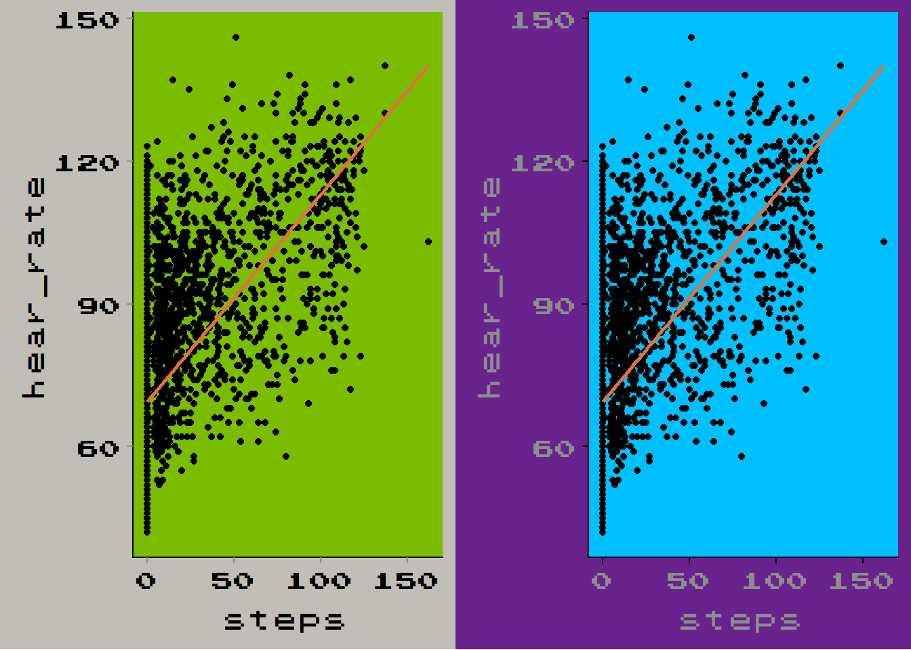

Alternatively, we could get a better look at the data by adding marginal density plots to the scatter-plots with the `ggMarginal()` function from the `ggExtra` package.

```
# Farming EXP

gb <- ggMarginal(gb, type = "histogram", fill="#79BC00")
gba <- ggMarginal(gba, type = "histogram", fill="#00BFFF")

plot_grid(gb, gba, labels = c("", ""), align = "h")
```

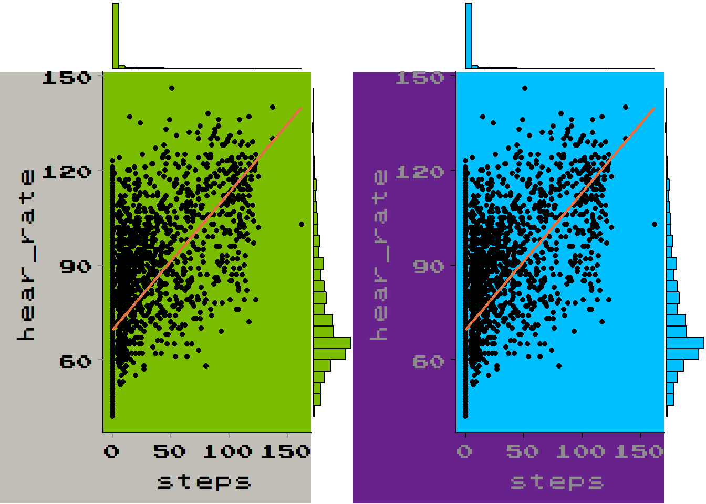


### Weekly Trends

* * *

Let’s take a quick look at the distribution of the contiguous variables to get a better idea than the mean and median.

```
# Loading..... Wait, what else were you expecting?

annotations_steps <- data_frame(
        x = c(45, 100, 165),
        y = c(0.01, 0.01, 0.01),
        label = c('walking pace', 'brisk walking pace', 'running pace'),
        type = c('steps', 'steps', 'steps')
)

g <- week %>%
  ggplot(aes(value)) +
  geom_density(fill = "#DE7243") +
  geom_text(data = annotations_steps, aes(x = x, y = y, label = label), angle = -30, hjust = 1) +
  facet_grid(.~type, scales = 'free_x') +
  labs(title = 'Heart Rate and Steps-per-minute over two months',
       subtitle = 'Data gathered from Fitbit Charge2')

g + theme_gameboy()
```

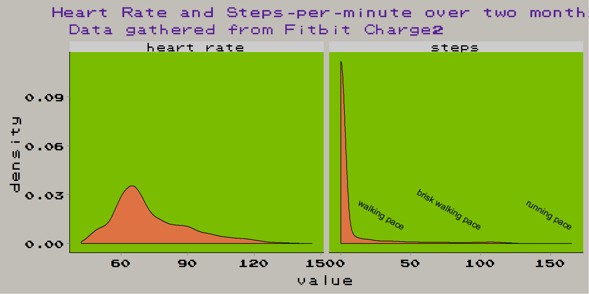

```
g + theme_gba()
```

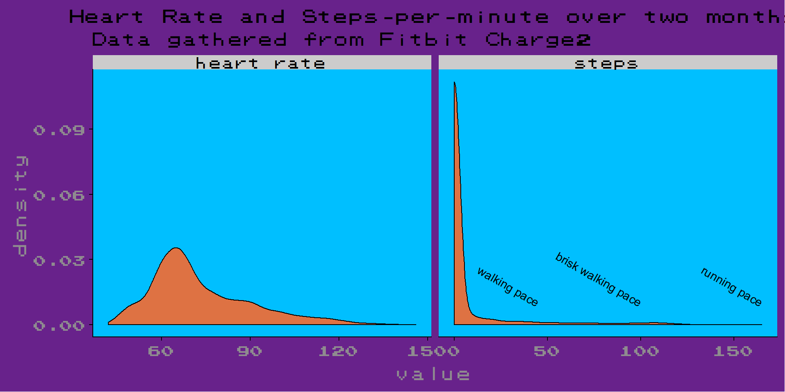

`Heart rate` is a little right-skewed, probably due to sleep and sedentary work. Similarly, for `step count` you see that only a small bump under `brisk walking pace` from when I skateboarded to work.


### Exercise Patterns

* * *

This week I didn’t work out so I thought I’d at least look at when I was on my way to work. The figure below shows blue for `heart rate/min` and orange is the number of `steps/min`.

```
# You are carrying too much to be able to run

between_six_nine <- function(time) time > 7*60*60 & time < 10*60*60

is_weekday <- function(day_of_week) day_of_week %in% 1:6

week$week_date_f <- factor(week$week_date, levels=c("Monday","Tuesday","Wednesday", "Thursday", "Friday", "Saturday"))

g <- week %>%
        filter(between_six_nine(time) & is_weekday(day_of_week)) %>%
        spread(type, value) %>%
        ggplot(aes(x = time)) +
        geom_bar(aes(y = steps), color = '#DE7243', alpha = 0.3, stat = 'identity') +
        geom_line(aes(y = `heart rate`), color = '#E3F24D', size = 0.8) +
        facet_grid(~week_date_f) +
        scale_x_continuous(breaks=c(27000, 30000, 33000, 36000), labels=c("7am", "8am", "9am", "10am"))

g + theme_gameboy()
```

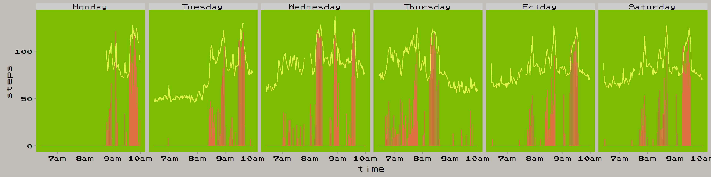

```
g + theme_gba()
```

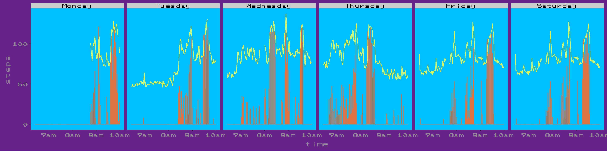

My activity has been pretty much the same all week since I skateboard to work every morning.


### Most Active Time Of The Week

* * *

```
# 60% of the time, it loads ALL the time

step_counts <- week %>%
  filter(type == 'steps') %>%
  group_by(day_of_week) %>%
  summarise(
    type = last(type),
    avg_num_steps = sprintf('avg num steps: %3.0f', sum(value)/52)
  )

g <- week %>%
        ggplot(aes(x= value, y = fct_rev(factor(day_of_week)))) +
        geom_density_ridges(scale = 2.5, fill = "#DE7243") +
        geom_text(data = step_counts, nudge_y = 0.15, hjust = 0,
            aes(x = 85, y = fct_rev(factor(day_of_week)), label = avg_num_steps)) +
        scale_y_discrete(breaks=1:6, labels = c("Monday", "Tuesday", "Wednesday", "Thursday", "Friday", "Saturday")) +
        facet_grid(.~type, scales = "free") +
        labs(x = '', y = "Day of the Week")

g + theme_gameboy()
```

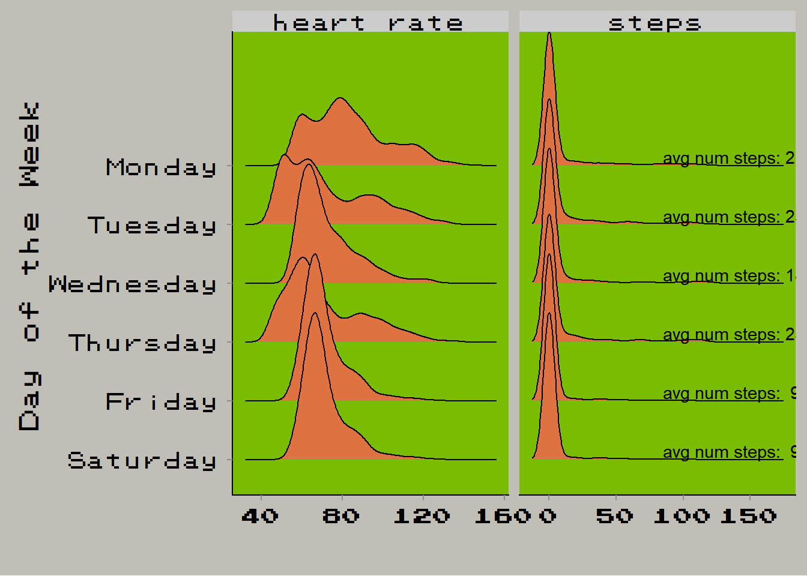

```
g + theme_gba()
```

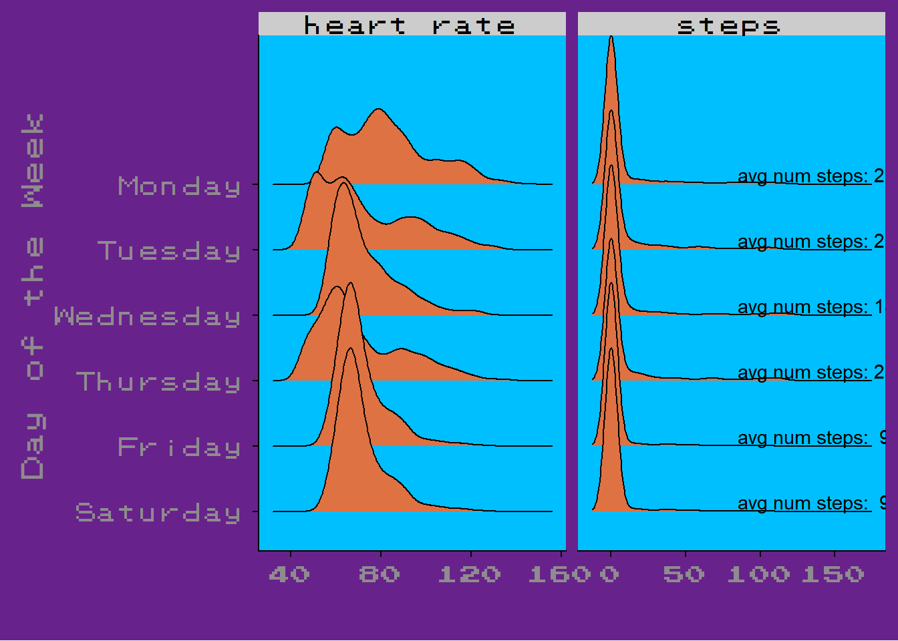

The distribution of steps per-minute was pretty constant because I didn’t work-out much that week.

It looks like Monday was the day I got my heart rate up the most, the bi modal peak is probably when I was running around looking for a rental property.


## Accessing The Fitbit API Directly With The `httr` Package

* * *

Eventually, I found an excellent [tutorial](https://obrl-soil.github.io/fitbit-api-r/) by [obrl-soil](https://github.com/obrl-soil) which introduced me to the `httr` package and gave me the confidence I needed to peruse the [Fitbit DEV web API reference](https://dev.fitbit.com/build/reference/web-api/). Now I was able to gain access to far more sources of data.

### What Data Is Available?

* * *

A brief overview of what data is available from the Fitbit API:

```
# Your Boko Club is badly damaged

# make a kable table for data you can access from Fitbit API
dt01 <- data.frame(Scope = c("activity",
                             "heartrate",
                             "location",
                             "nutrition",
                             "profile",
                             "settings",
                             "sleep",
                             "social",
                             "weight"),
                   Description = c("The activity scope includes activity data and exercise log related features, such as steps, distance, calories burned, and active minutes",
                                   "The heartrate scope includes the continuous heart rate data and related analysis",
                                   "The location scope includes the GPS and other location data",
                                   "The nutrition scope includes calorie consumption and nutrition related features, such as food/water logging, goals, and plans",
                                   "The profile scope is the basic user information",
                                   "The settings scope includes user account and device settings, such as alarms",
                                   "The sleep scope includes sleep logs and related sleep analysis",
                                   "The social scope includes friend-related features, such as friend list, invitations, and leaderboard",
                                   "The weight scope includes weight and related information, such as body mass index, body fat percentage, and goals")
)

dt01 %>%
  kable("html") %>%
  kable_styling(full_width = F) %>%
  column_spec(1, bold = T, border_right = T) %>%
  column_spec(2, width = "30em", background = "#E3F24D")
```

<table class="table"><thead><tr><th>Scope</th><th>Description</th></tr></thead><tbody><tr><td>activity</td><td>The activity scope includes activity data and exercise log related features, such as steps, distance, calories burned, and active minutes</td></tr><tr><td>heartrate</td><td>The heartrate scope includes the continuous heart rate data and related analysis</td></tr><tr><td>location</td><td>The location scope includes the GPS and other location data</td></tr><tr><td>nutrition</td><td>The nutrition scope includes calorie consumption and nutrition related features, such as food/water logging, goals, and plans</td></tr><tr><td>profile</td><td>The profile scope is the basic user information</td></tr><tr><td>settings</td><td>The settings scope includes user account and device settings, such as alarms</td></tr><tr><td>sleep</td><td>The sleep scope includes sleep logs and related sleep analysis</td></tr><tr><td>social</td><td>The social scope includes friend-related features, such as friend list, invitations, and leaderboard</td></tr><tr><td>weight</td><td>The weight scope includes weight and related information, such as body mass index, body fat percentage, and goals</td></tr></tbody></table>

What are the units of measurement?

```
# Loading Cutscenes You Can't Skip

# make a Kable table or measurement information
dt03 <- data.frame(unitType = c("duration",
                                "distance",
                                "elevation",
                                "height",
                                "weight",
                                "body measurements",
                                "liquids",
                                "blood glucose"),
                   unit = c("milliseconds",
                            "kilometers",
                            "meters",
                            "centimeters",
                            "kilograms",
                            "centimeters",
                            "milliliters",
                            "millimoles per liter"))
dt03 %>%
  kable("html") %>%
  kable_styling(full_width = F) %>%
  column_spec(1, bold = T, border_right = T) %>%
  column_spec(2, width = "30em", background = "#E3F24D")
```

<table class="table"><thead><tr><th>unitType</th><th>unit</th></tr></thead><tbody><tr><td>duration</td><td>milliseconds</td></tr><tr><td>distance</td><td>kilometers</td></tr><tr><td>elevation</td><td>meters</td></tr><tr><td>height</td><td>centimeters</td></tr><tr><td>weight</td><td>kilograms</td></tr><tr><td>body measurements</td><td>centimeters</td></tr><tr><td>liquids</td><td>milliliters</td></tr><tr><td>blood glucose</td><td>millimoles per liter</td></tr></tbody></table>

Define a function for turning a `json` list into a data frame.

```
# Inserting last-minute subroutines into program...

# json-as-list to dataframe (for simple cases without nesting!)
jsonlist_to_df <- function(data = NULL) {
    purrr::transpose(data) %>%
    purrr::map(., unlist) %>%
    as_tibble(., stringsAsFactors = FALSE)
}
```

### Investigating My 10Km Run

* * *

`GET` request to retrieve minute-by-minute heart rate data for my 10km run.

```
# Preparing for the mini-boss

get_workout <- function(date = NULL, start_time = NULL, end_time = NULL,
                         token = Sys.getenv('FITB_AUTH')) {
GET(url =
        paste0('https://api.fitbit.com/1/user/-/activities/heart/date/',
        date, '/1d/1min/time/', start_time, '/', end_time, '.json'),
        add_headers(Authorization = paste0("Bearer ", token)))
}

# Get the workout for my 10Km run
got_workout <- get_workout(date = '2018-10-21', start_time = '09:29', end_time = '10:24')

workout <- content(got_workout)

# summary

workout[['activities-heart']][[1]][['heartRateZones']] <- jsonlist_to_df(workout[['activities-heart']][[1]][['heartRateZones']])

# the dataset
workout[['activities-heart-intraday']][['dataset']] <- jsonlist_to_df(workout[['activities-heart-intraday']][['dataset']])

# format the time
workout$`activities-heart-intraday`$dataset$time <- as.POSIXlt(workout$`activities-heart-intraday`$dataset$time, format = '%H:%M:%S')
lubridate::date(workout$`activities-heart-intraday`$dataset$time) <- '2018-10-21'

# find time zone
# grep("Canada", OlsonNames(), value=TRUE)
lubridate::tz(workout$`activities-heart-intraday`$dataset$time) <- 'Canada/Eastern'
```

Let’s take a look at the summary for my 10Km run:

```
# Farming Hell Cows

workout$`activities-heart`[[1]]$heartRateZones %>% kable() %>% kable_styling(full_width = F)
```

<table class="table"><thead><tr><th>caloriesOut</th><th>max</th><th>min</th><th>minutes</th><th>name</th></tr></thead><tbody><tr><td>0.00000</td><td>95</td><td>30</td><td>0</td><td>Out of Range</td></tr><tr><td>13.13763</td><td>133</td><td>95</td><td>2</td><td>Fat Burn</td></tr><tr><td>429.58982</td><td>161</td><td>133</td><td>38</td><td>Cardio</td></tr><tr><td>192.79205</td><td>220</td><td>161</td><td>16</td><td>Peak</td></tr></tbody></table>

According to this I spent ~29% of the run at my `peak` heart rate and ~69% of it in `cardio` mode.

* * *

[obrl-soil](https://obrl-soil.github.io/fitbit-api-r/) used the `MyZone Efforts Points` [(MEPS)](https://myzone.org/the-zones/) which is calculated minute-by-minute as a percentage of max heart rate. It measures the effort put in - The more points the better. Another example of `gamification` in action.

```
# Looting a chest

meps_max <- function(age = NULL) { 207 - (0.7 * age) }
```

Mine is 186.

Now create a tribble of 4 heart ranges along with `mutate()` to calculate what my max heart rate is (with lower and upper bounds).

```
# Taking the hobbits to Isengard

my_MEPS <- tribble(~MEPS, ~hr_range, ~hr_lo, ~hr_hi,
                       1,  '50-59%',   0.50,   0.59,
                       2,  '60-69%',   0.60,   0.69,
                       3,  '70-79%',   0.70,   0.79,
                       4,    '>=80',   0.80,   1.00) %>%
  mutate(my_hr_low = floor(meps_max(30) * hr_lo),
         my_hr_hi  = ceiling(meps_max(30) * hr_hi))
my_MEPS
```

```
## # A tibble: 4 x 6
##    MEPS hr_range hr_lo hr_hi my_hr_low my_hr_hi
##   <dbl> <chr>    <dbl> <dbl>     <dbl>    <dbl>
## 1     1 50-59%     0.5  0.59        93      110
## 2     2 60-69%     0.6  0.69       111      129
## 3     3 70-79%     0.7  0.79       130      147
## 4     4 >=80       0.8  1          148      186
```

With the equation now defined let’s calculate my total `MEPS`:

```
# Checkpoint!

mep <- mutate(workout$`activities-heart-intraday`$dataset,
       meps = case_when(value >= 146 ~ 4,
                        value >= 128 ~ 3,
                        value >= 109 ~ 2,
                        value >= 91  ~ 1,
                        TRUE ~ 0)) %>%
  summarise("Total MEPS" = sum(meps))
```

Wow it’s 216!

I’m not sure what that exactly means but apparently the maxim possible MEPS in a 42-minute workout is 168 and since I ran this 10Km in 54:35 I guess that’s good?

I’d like to post sub 50 minutes on my next 10Km run but I’m not sure if I should be aiming to shoot for a greater percentage of `peak` heart rate minutes or not - guess I will need to look into this.

### Minute-by-Minute Sleep Data For One Night

* * *

Let’s examine my sleep patterns last night.

```
# Resting at Campfire

get_sleep <- function(startDate = NULL, endDate = NULL, token = Sys.getenv('FITB_AUTH')){
        GET(url = paste0('https://api.fitbit.com/1.2/user/-/sleep/date/', startDate, "/", endDate, '.json'),
        add_headers(Authorization = paste0("Bearer ", token)))
}

# make sure that there is data for those days otherwise it tosses an error

got_sleep <- get_sleep(startDate = "2018-08-21", endDate = "2018-08-22")
sleep <- content(got_sleep)

dateRange <- seq(as.Date("2018-08-21"), as.Date("2018-08-22"), "days")

sleep_pattern <- NULL
for(j in 1:length(dateRange)){
        sleep[['sleep']][[j]][['levels']][['data']] <- jsonlist_to_df(sleep[['sleep']][[j]][['levels']][['data']])
        tmp <- sleep$sleep[[j]]$levels$`data`
sleep_pattern <- bind_rows(sleep_pattern, tmp)
}
```

Okay now that the data munging is complete, let’s look at my sleep pattern.

```
# Now entering... The Twilight Zone

g <- sleep_pattern %>% group_by(level, seconds) %>%
        summarise() %>%
        summarise(seconds = sum(seconds)) %>%
        mutate(percentage = seconds/sum(seconds)) %>%
                ggplot(aes(x = "", y = percentage, fill = c("S", "A", "R"))) +
                        geom_bar(width = 1, stat = "identity") +
                        theme(axis.text.y = element_blank(),
                              axis.text.x = element_blank(), axis.line = element_blank(), plot.caption = element_text(size = 5), plot.title = element_blank()) +
                        labs(fill = "class", x = NULL, y = NULL, title = "Sleep stages", caption = "A = Awake; R = Restless; S = Asleep") +
                        coord_polar(theta = "y", start = 0) +
        scale_fill_manual(values = c("#FF3F3F", "#2BD1FC", "#BA90A6"))

g + theme_gameboy()
```

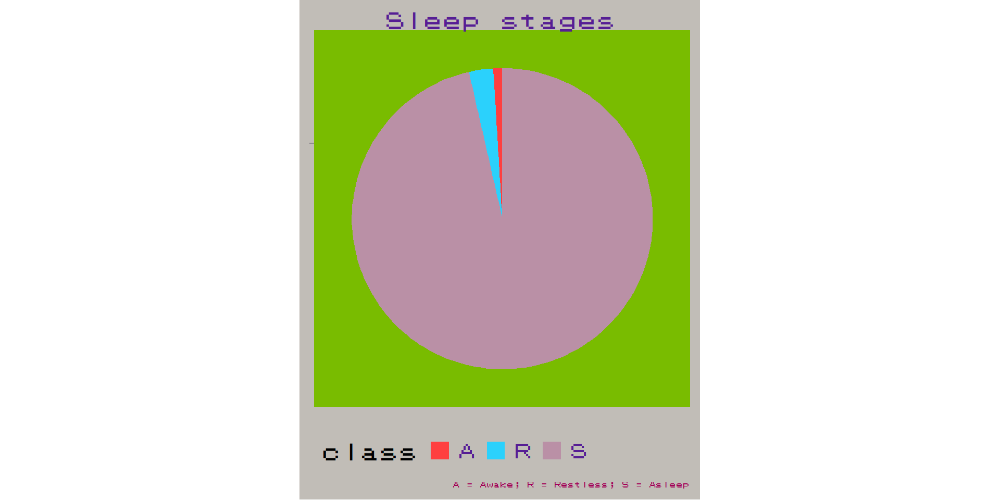

```
g + theme_gba()
```

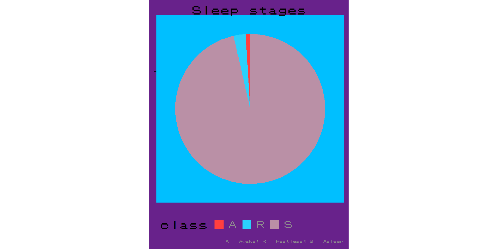

A pie chart is probably not the best way to show this data. Let’s visualize the distribution with a box plot.

```
# Entering Cheat Codes!

g <- ggplot(sleep_pattern, aes(y=log10(seconds), x=level)) +
        geom_boxplot(color="#031300", fill='#152403') +
        labs(x = "", title = 'Sleep patterns over a month',
       subtitle = 'Data gathered from Fitbit Charge2') +
        theme(legend.position = "none")

g + theme_gameboy()
```

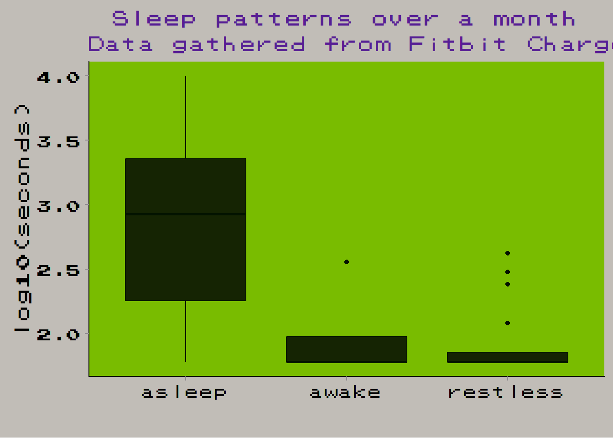

```
g + theme_gba()
```

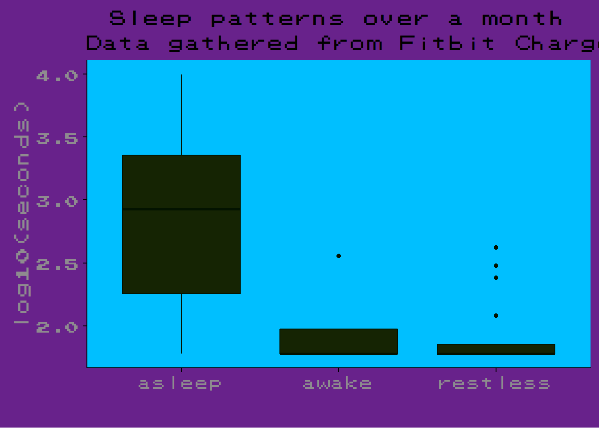

An even better way to visualize the distribution would be to use a violin plot with the raw data points overlaid.

```
# Neglecting Sleep...


g <- ggplot(sleep_pattern, aes(y=log10(seconds), x=level)) +
        geom_violin(color="#031300", fill='#152403') +
        geom_point() +
        labs(x = "", title = 'Sleep patterns over a month',
       subtitle = 'Data gathered from Fitbit Charge2') +
        theme(legend.position = "none")

g + theme_gameboy()
```

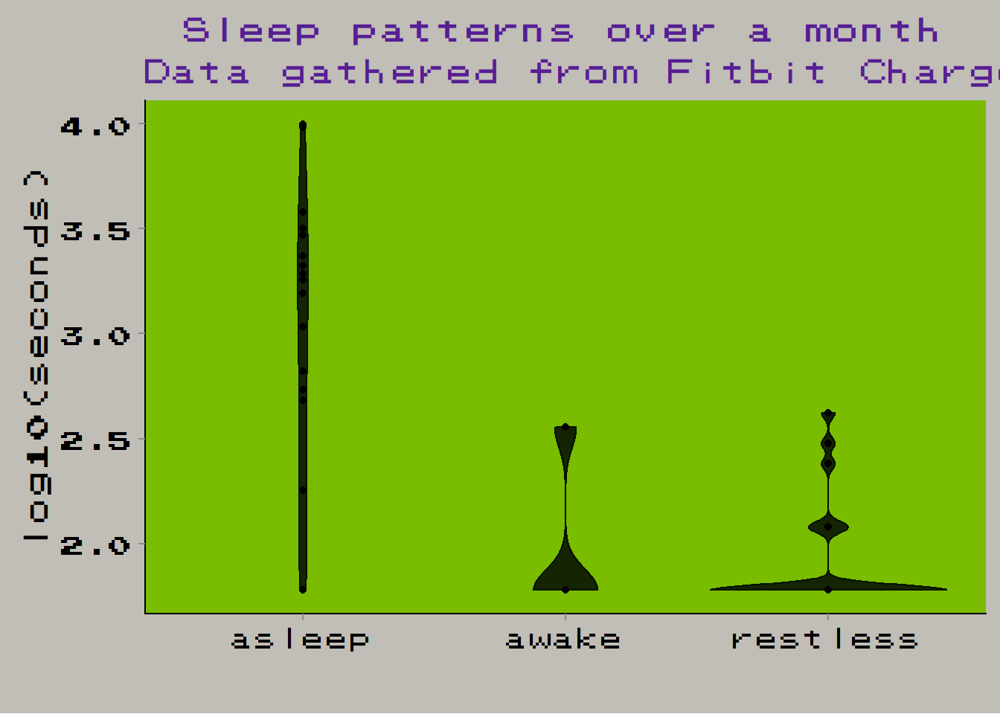

```
g + theme_gba()
```

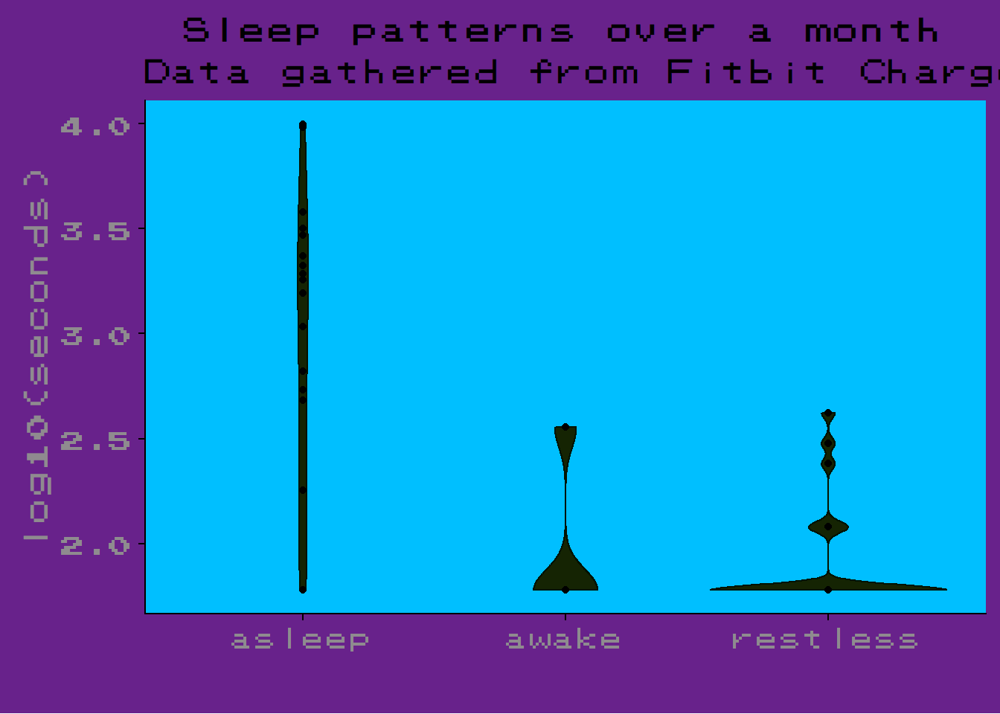


### Daily Activity Patterns For 3 Months

* * *

You can do API requests for various periods from the Fitbit [Activity and Exercise Logs](https://dev.fitbit.com/build/reference/web-api/activity/) but since I’ve only had mine a couple months I’ll use the `3m` period.

I will also need to trim off any day’s which are in the future otherwise they’ll appear as `0` calories in the figures. It’s best to use the `Sys.Date()` function rather than hard coding the date when doing `EDA`, making a Shiny app, or [parameterizing a `RMarkdown` file](https://resources.rstudio.com/rstudio-connect-2/parameterized-r-markdown-reports-with-rstudio-connect-aron-atkins). This way you can explore different time periods without anything breaking.

I cannot remember when I started wearing my Fitbit but we can figure that out with the following code:

```
# ULTIMATE IS READY!

# Query how many days since you've had fitbit for
inception <- user_info$memberSince
```

I’ve had my Fitbit since 2018-08-20.


Let’s gather data from September 20 until November 6 2018.

```
# Catching them all!

### Calories
get_calories <- function(baseDate = NULL, period = NULL, token = Sys.getenv('FITB_AUTH')){
        GET(url = paste0('https://api.fitbit.com/1/user/-/activities/calories/date/', baseDate, "/", period, '.json'),
        add_headers(Authorization = paste0("Bearer ", token)))
}

got_calories <- get_calories(baseDate = "2018-11-20", period = "3m")
calories <- content(got_calories)
# turn into df
calories[['activities-calories']] <- jsonlist_to_df(calories[['activities-calories']])
# assign easy object and rename
calories <- calories[['activities-calories']]
colnames(calories) <- c("dateTime", "calories")

### STEPS
get_steps <- function(baseDate = NULL, period = NULL, token = Sys.getenv('FITB_AUTH')){
        GET(url = paste0('https://api.fitbit.com/1/user/-/activities/steps/date/', baseDate, "/", period, '.json'),
        add_headers(Authorization = paste0("Bearer ", token)))
}

got_steps <- get_steps(baseDate = "2018-11-20", period = "3m")
steps <- content(got_steps)
# turn into df
steps[['activities-steps']] <- jsonlist_to_df(steps[['activities-steps']])
# assign easy object and rename
steps <- steps[['activities-steps']]
colnames(steps) <- c("dateTime", "steps")

### DISTANCE
get_distance <- function(baseDate = NULL, period = NULL, token = Sys.getenv('FITB_AUTH')){
        GET(url = paste0('https://api.fitbit.com/1/user/-/activities/distance/date/', baseDate, "/", period, '.json'),
        add_headers(Authorization = paste0("Bearer ", token)))
}

got_distance <- get_distance(baseDate = "2018-11-20", period = "3m")
distance <- content(got_distance)
# turn into df
distance[['activities-distance']] <- jsonlist_to_df(distance[['activities-distance']])
# assign easy object and rename
distance <- distance[['activities-distance']]
colnames(distance) <- c("dateTime", "distance")

### FLOORS
get_floors <- function(baseDate = NULL, period = NULL, token = Sys.getenv('FITB_AUTH')){
        GET(url = paste0('https://api.fitbit.com/1/user/-/activities/floors/date/', baseDate, "/", period, '.json'),
        add_headers(Authorization = paste0("Bearer ", token)))
}

got_floors <- get_floors(baseDate = "2018-11-20", period = "3m")
floors <- content(got_floors)
# turn into df
floors[['activities-floors']] <- jsonlist_to_df(floors[['activities-floors']])
# assign easy object and rename
floors <- floors[['activities-floors']]
colnames(floors) <- c("dateTime", "floors")

### ELEVATION
get_elevation <- function(baseDate = NULL, period = NULL, token = Sys.getenv('FITB_AUTH')){
        GET(url = paste0('https://api.fitbit.com/1/user/-/activities/elevation/date/', baseDate, "/", period, '.json'),
        add_headers(Authorization = paste0("Bearer ", token)))
}

got_elevation <- get_elevation(baseDate = "2018-11-20", period = "3m")
elevation <- content(got_elevation)
# turn into df
elevation[['activities-elevation']] <- jsonlist_to_df(elevation[['activities-elevation']])
# assign easy object and rename
elevation <- elevation[['activities-elevation']]
colnames(elevation) <- c("dateTime", "elevation")

### minutesSedentary
get_minutesSedentary <- function(baseDate = NULL, period = NULL, token = Sys.getenv('FITB_AUTH')){
        GET(url = paste0('https://api.fitbit.com/1/user/-/activities/minutesSedentary/date/', baseDate, "/", period, '.json'),
        add_headers(Authorization = paste0("Bearer ", token)))
}

got_minutesSedentary <- get_minutesSedentary(baseDate = "2018-11-20", period = "3m")
minutesSedentary <- content(got_minutesSedentary)
# turn into df
minutesSedentary[['activities-minutesSedentary']] <- jsonlist_to_df(minutesSedentary[['activities-minutesSedentary']])
# assign easy object and rename
minutesSedentary <- minutesSedentary[['activities-minutesSedentary']]
colnames(minutesSedentary) <- c("dateTime", "minutesSedentary")

### minutesLightlyActive
get_minutesLightlyActive <- function(baseDate = NULL, period = NULL, token = Sys.getenv('FITB_AUTH')){
        GET(url = paste0('https://api.fitbit.com/1/user/-/activities/minutesLightlyActive/date/', baseDate, "/", period, '.json'),
        add_headers(Authorization = paste0("Bearer ", token)))
}

got_minutesLightlyActive <- get_minutesLightlyActive(baseDate = "2018-11-20", period = "3m")
minutesLightlyActive <- content(got_minutesLightlyActive)
# turn into df
minutesLightlyActive[['activities-minutesLightlyActive']] <- jsonlist_to_df(minutesLightlyActive[['activities-minutesLightlyActive']])
# assign easy object and rename
minutesLightlyActive <- minutesLightlyActive[['activities-minutesLightlyActive']]
colnames(minutesLightlyActive) <- c("dateTime", "minutesLightlyActive")

### minutesFairlyActive
get_minutesFairlyActive <- function(baseDate = NULL, period = NULL, token = Sys.getenv('FITB_AUTH')){
        GET(url = paste0('https://api.fitbit.com/1/user/-/activities/minutesFairlyActive/date/', baseDate, "/", period, '.json'),
        add_headers(Authorization = paste0("Bearer ", token)))
}

got_minutesFairlyActive <- get_minutesFairlyActive(baseDate = "2018-11-20", period = "3m")
minutesFairlyActive <- content(got_minutesFairlyActive)
# turn into df
minutesFairlyActive[['activities-minutesFairlyActive']] <- jsonlist_to_df(minutesFairlyActive[['activities-minutesFairlyActive']])
# assign easy object and rename
minutesFairlyActive <- minutesFairlyActive[['activities-minutesFairlyActive']]
colnames(minutesFairlyActive) <- c("dateTime", "minutesFairlyActive")

### minutesVeryActive
get_minutesVeryActive <- function(baseDate = NULL, period = NULL, token = Sys.getenv('FITB_AUTH')){
        GET(url = paste0('https://api.fitbit.com/1/user/-/activities/minutesVeryActive/date/', baseDate, "/", period, '.json'),
        add_headers(Authorization = paste0("Bearer ", token)))
}

got_minutesVeryActive <- get_minutesVeryActive(baseDate = "2018-11-20", period = "3m")
minutesVeryActive <- content(got_minutesVeryActive)
# turn into df
minutesVeryActive[['activities-minutesVeryActive']] <- jsonlist_to_df(minutesVeryActive[['activities-minutesVeryActive']])
# assign easy object and rename
minutesVeryActive <- minutesVeryActive[['activities-minutesVeryActive']]
colnames(minutesVeryActive) <- c("dateTime", "minutesVeryActive")

### activityCalories
get_activityCalories <- function(baseDate = NULL, period = NULL, token = Sys.getenv('FITB_AUTH')){
        GET(url = paste0('https://api.fitbit.com/1/user/-/activities/activityCalories/date/', baseDate, "/", period, '.json'),
        add_headers(Authorization = paste0("Bearer ", token)))
}

got_activityCalories <- get_activityCalories(baseDate = "2018-11-20", period = "3m")
activityCalories <- content(got_activityCalories)
# turn into df
activityCalories[['activities-activityCalories']] <- jsonlist_to_df(activityCalories[['activities-activityCalories']])
# assign easy object and rename
activityCalories <- activityCalories[['activities-activityCalories']]
colnames(activityCalories) <- c("dateTime", "activityCalories")

##### Join multiple dataframes with purrr::reduce and dplyr::left_join
activity_df <- list(calories, steps, distance, floors, elevation, activityCalories, minutesSedentary, minutesLightlyActive, minutesFairlyActive, minutesVeryActive) %>%
        purrr::reduce(left_join, by = "dateTime")

# Add the dateTime to this dataframe
activity_df$dateTime <- as.Date(activity_df$dateTime)

names <- c(2:ncol(activity_df))
activity_df[,names] <- lapply(activity_df[,names], as.numeric)

# trim off any days that haven't happened yet
activity_df %<>% filter(dateTime <= "2018-11-06")
```


### Get Recent Activity Types

* * *

```
# We're giving it all she's got!

get_frequentActivities <- function(baseDate = NULL, period = NULL, token = Sys.getenv('FITB_AUTH')){
    GET(url = paste0('https://api.fitbit.com/1/user/-/activities/recent.json'),
        add_headers(Authorization = paste0("Bearer ", token)))
}

got_frequentActivities <- get_frequentActivities(baseDate = "2018-11-20", period = "3m")
frequentActivities <- content(got_frequentActivities)
# This is a list object let's look at how many frequent activities are logged
length(frequentActivities)
```

```
## [1] 5
```

```
# Take a look at the object with str()
str(frequentActivities)
```

```
## List of 5
##  $ :List of 6
##   ..$ activityId : int 2131
##   ..$ calories   : int 0
##   ..$ description: chr ""
##   ..$ distance   : int 0
##   ..$ duration   : int 3038000
##   ..$ name       : chr "Weights"
##  $ :List of 6
##   ..$ activityId : int 90009
##   ..$ calories   : int 0
##   ..$ description: chr "Running - 5 mph (12 min/mile)"
##   ..$ distance   : int 0
##   ..$ duration   : int 1767000
##   ..$ name       : chr "Run"
##  $ :List of 6
##   ..$ activityId : int 90013
##   ..$ calories   : int 0
##   ..$ description: chr "Walking less than 2 mph, strolling very slowly"
##   ..$ distance   : int 0
##   ..$ duration   : int 2407000
##   ..$ name       : chr "Walk"
##  $ :List of 6
##   ..$ activityId : int 90001
##   ..$ calories   : int 0
##   ..$ description: chr "Very Leisurely - Less than 10 mph"
##   ..$ distance   : int 0
##   ..$ duration   : int 4236000
##   ..$ name       : chr "Bike"
##  $ :List of 6
##   ..$ activityId : int 15000
##   ..$ calories   : int 0
##   ..$ description: chr ""
##   ..$ distance   : int 0
##   ..$ duration   : int 1229000
##   ..$ name       : chr "Sport"
```

I would never have considered myself a [Darwin](https://www.psychologytoday.com/us/blog/how-think-about-exercise/201501/charles-darwins-daily-walks) or a [Thoreau](https://en.wikipedia.org/wiki/Walking_\(Thoreau\)) but apparently _strolling very slowly_ is my favorite activity in terms of time spent.

You can see that my Fitbit has also logged times for `Weights`, `Sports` and `Biking` which is likely from when I’ve manually logged my activities. There’s a possibility that Fitbit is registering `Biking` for when I skateboard.


### Correlogram of Activity

* * *

Previously I had always used the `corrplot` package to create a correlation plot; however, it doesn’t play nicely with `ggplot` meaning you cannot add `Game Boy` themes easily. Nonetheless, I was able to give it a retro-looking palette with some minor tweaking.

Since I had two colors in mind from the original `gameboy`, and knew their `hex` code, I was able to [generate a palette from this website](https://meyerweb.com/eric/tools/color-blend/#CADCA0:0F380E:10:hex).

```
# Aligning Covariance Matrices

# drop dateTime
corr_df <- activity_df[,2:11]

# Correlation matrix
corr <- cor(na.omit(corr_df))
corrplot(corr, type = "upper", bg = "#9BBB0E", tl.col = "#565656", col = c("#CADCA0", "#B9CD93", "#A8BE85", "#97AF78", "#86A06B", "#75915E", "#648350", "#537443", "#426536", "#315629", "#20471B", "#0F380E"))
```

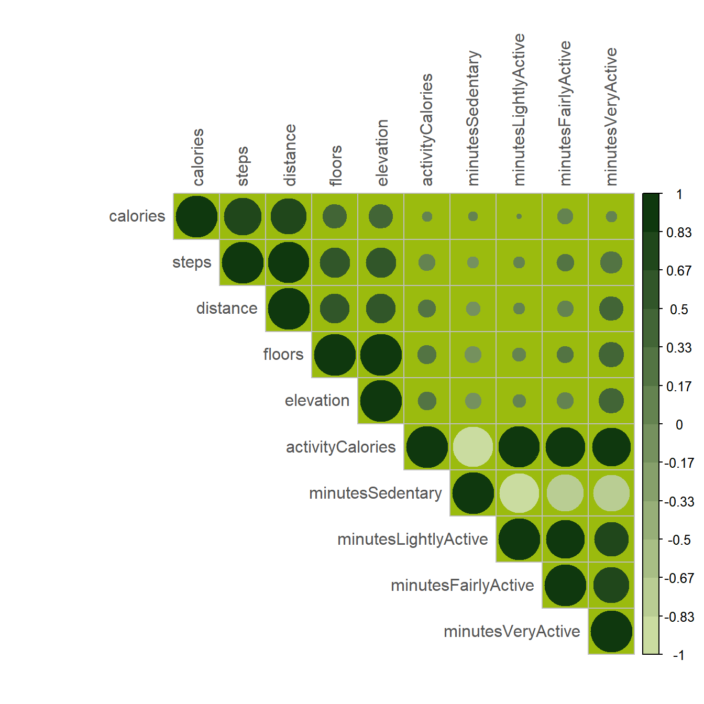

In a correlation plot the color of each circle indicates the magnitude of the correlation, and the size of the circle indicates its significance.

After a bit of searching for a `ggplot2` extension I was able to use `ggcorrplot` which allowed me to use `gameboy` themes again!

```
# Generating textures...

ggcorrplot(corr, hc.order = TRUE,
           type = "lower",
           lab = TRUE,
           lab_size = 2,
           tl.cex = 8,
           show.legend = FALSE,
           colors = c( "#306230", "#306230", "#0F380F" ),
           title="Correlogram",
           ggtheme=theme_gameboy)
```

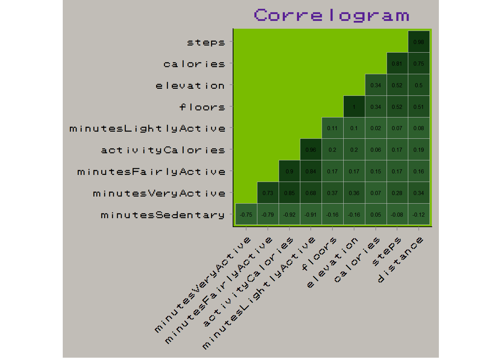

```
# Game Over. Loading previous save

ggcorrplot(corr, hc.order = TRUE,
           type = "lower",
           lab = TRUE,
           lab_size = 2,
           tl.cex = 8,
           show.legend = FALSE,
           colors = c( "#3B7AAD", "#56B1F7", "#1D3E5D" ),
           title="Correlogram",
           ggtheme=theme_gba)
```

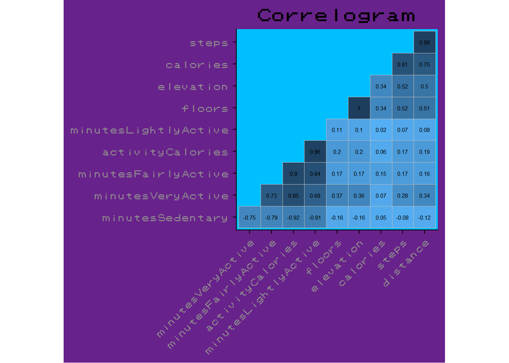


### Exploring Activity

* * *

#### Calories

* * *

```
# Link saying "hyahhh!"

# Static
g <- activity_df %>%
        ggplot(aes(x=dateTime, y=calories)) +
        geom_line(colour = "black") +
        geom_point(shape = 21, colour = "black", aes(fill = calories), size = 5, stroke = 1) +
        xlab("") +
        ylab("Calorie Expenditure")

g + theme_gameboy() + theme(legend.position = "none")
```

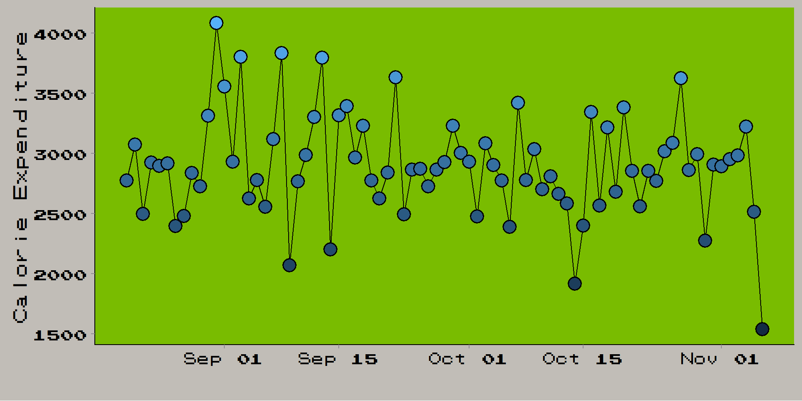

```
g + theme_gba() + theme(legend.position = "none")
```

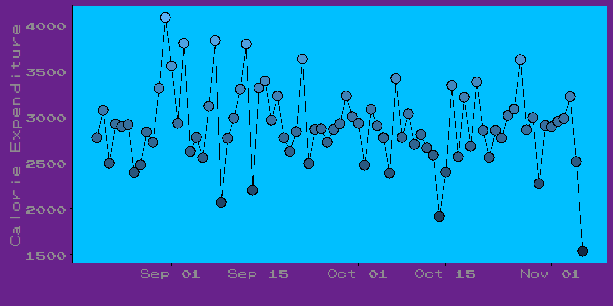

```
# Panick! at the Discord...

# gganimate
g <- activity_df %>%
        ggplot(aes(x=dateTime, y=calories)) +
        geom_line(colour = "black") +
        geom_point(shape = 21, colour = "black", aes(fill = calories), size = 5, stroke = 1) +
        transition_time(dateTime) +
        shadow_mark() +
        ease_aes('linear') +
        xlab("") +
        ylab("Calorie Expenditure")

g + theme_gba() + theme(legend.position = "none")
```

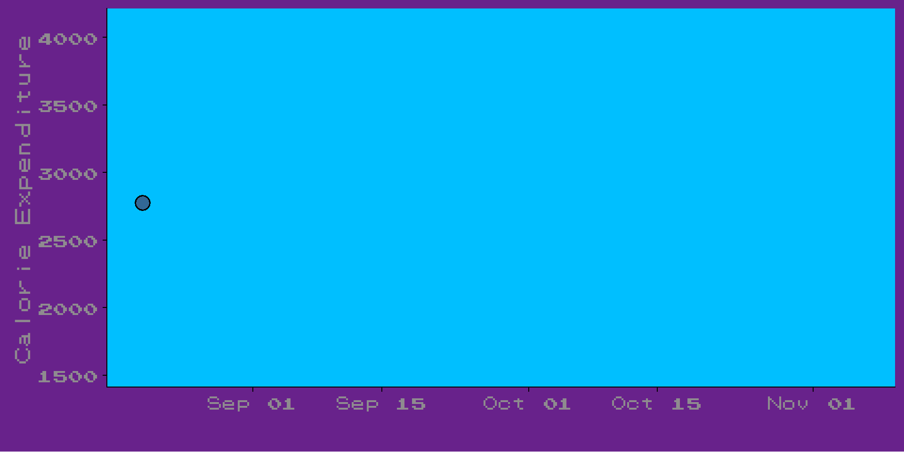

It would be nice to get the **intraday time series** but this is currently only granted on a case-by-case basis. It’s mentioned in the documentation that **“Fitbit is very supportive of non-profit research and personal projects. Commercial applications require thorough review and are subject to additional requirements.”** This is a process I would need to undertake if this project were to move forward.

#### Distance

* * *

```
# Falcon punching

# Static
g <- activity_df %>%
        ggplot(aes(x=dateTime, y=distance)) +
        geom_line(colour = "black") +
        geom_point(shape = 21, colour = "black", aes(fill = distance), size = 5, stroke = 1) +
        xlab("") +
        ylab("Distance Travelled (m)")

g + theme_gameboy() + theme(legend.position = "none")
```

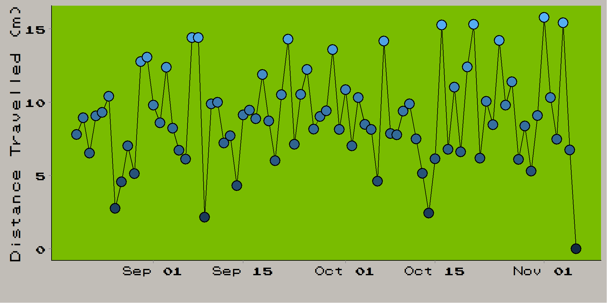

```
g + theme_gba() + theme(legend.position = "none")
```

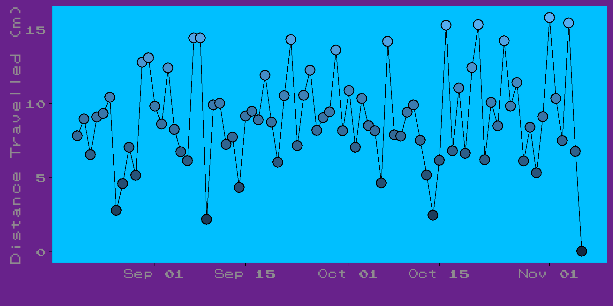

```
# gganimate
activity_df %>%
        ggplot(aes(x=dateTime, y=distance)) +
        geom_line(colour = "black") +
        geom_point(shape = 21, colour = "black", aes(fill = distance), size = 5, stroke = 1) +
        theme_gba() +
        transition_time(dateTime) +
        shadow_mark() +
        ease_aes('linear') +
        xlab("") +
        ylab("Distance Travelled (m)") +
        theme(legend.position = "none")
```


Distance is determined by using your steps and your estimated stride length (for the height you put in).

#### Steps

* * *

```
# Telling Mario the Princess is in another castle

# Static
g <- activity_df %>%
        ggplot(aes(x=dateTime, y=steps)) +
        geom_line(colour = "black") +
        geom_point(shape = 21, colour = "black", aes(fill = steps), size = 5, stroke = 1) +
        xlab("") +
        ylab("Steps Taken")

g + theme_gameboy() + theme(legend.position = "none")
```

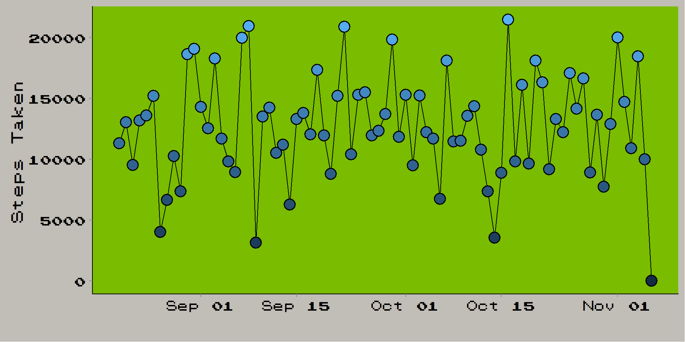

```
g + theme_gba() + theme(legend.position = "none")
```

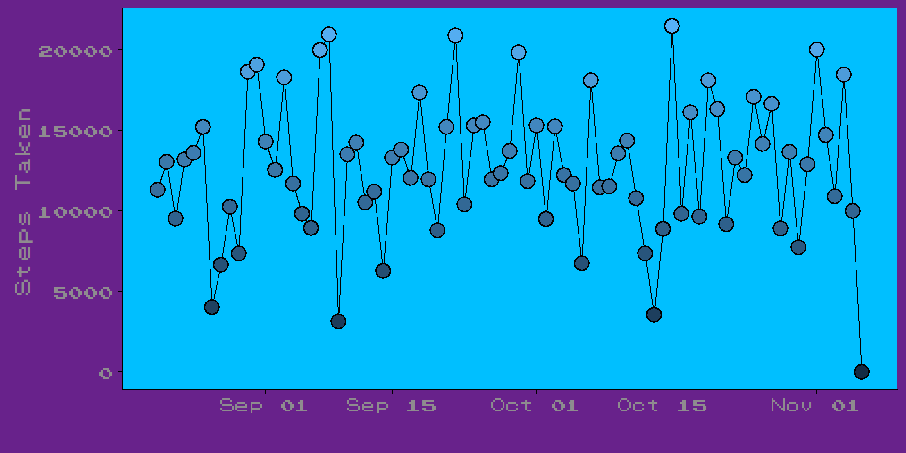

```
# gganimate
g <- activity_df %>%
        ggplot(aes(x=dateTime, y=steps)) +
        geom_line(colour = "black") +
        geom_point(shape = 21, colour = "black", aes(fill = steps), size = 5, stroke = 1) +
        transition_time(dateTime) +
        shadow_mark() +
        ease_aes('linear') +
        xlab("") +
        ylab("Steps Taken")

g + theme_gameboy() + theme(legend.position = "none")
g + theme_gba() + theme(legend.position = "none")
```

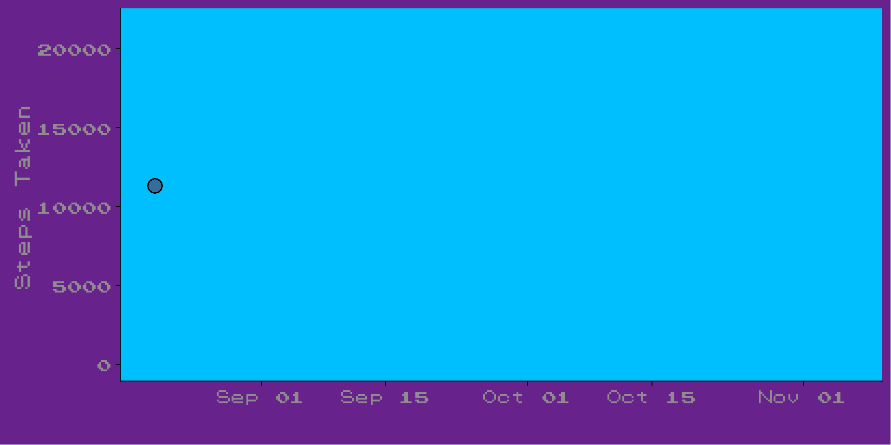

#### Elevation

* * *

```
# Insert Coin to Continue

# Static
g <- activity_df %>%
        ggplot(aes(x=dateTime, y=elevation)) +
        geom_line(colour = "black") +
        geom_point(shape = 21, colour = "black", aes(fill = elevation), size = 5, stroke = 1) +
        xlab("") +
        ylab("Elevation Gained (m)")

g + theme_gameboy() + theme(legend.position = "none")
```

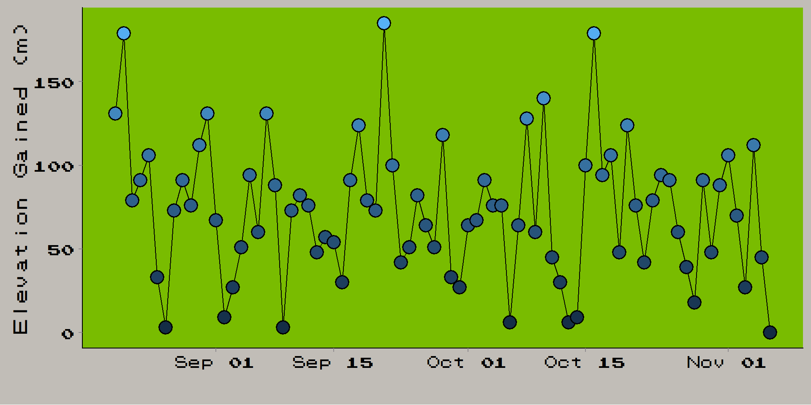

```
g + theme_gba() + theme(legend.position = "none")
```

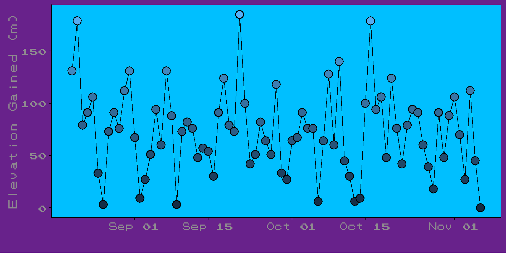

```
# gganimate
g <- activity_df %>%
        ggplot(aes(x=dateTime, y=elevation)) +
        geom_line(colour = "black") +
        geom_point(shape = 21, colour = "black", aes(fill = elevation), size = 5, stroke = 1) +
        transition_time(dateTime) +
        shadow_mark() +
        ease_aes('linear') +
        xlab("") +
        ylab("Elevation Gained (m)")

g + theme_gameboy() + theme(legend.position = "none")
g + theme_gba() + theme(legend.position = "none")
```

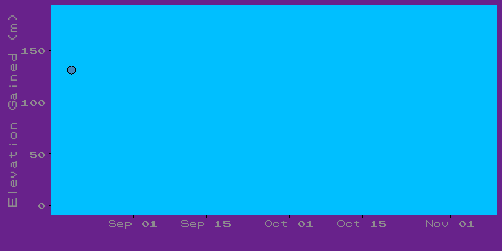

#### Floors

* * *

```
# Ready Player One

# Static
g <- activity_df %>%
        ggplot(aes(x=dateTime, y=floors)) +
        geom_line(colour = "black") +
        geom_point(shape = 21, colour = "black", aes(fill = floors), size = 5, stroke = 1) +
        xlab("") +
        ylab("Floors Ascended") +
        theme(legend.position = "none")

g + theme_gameboy() + theme(legend.position = "none")
```

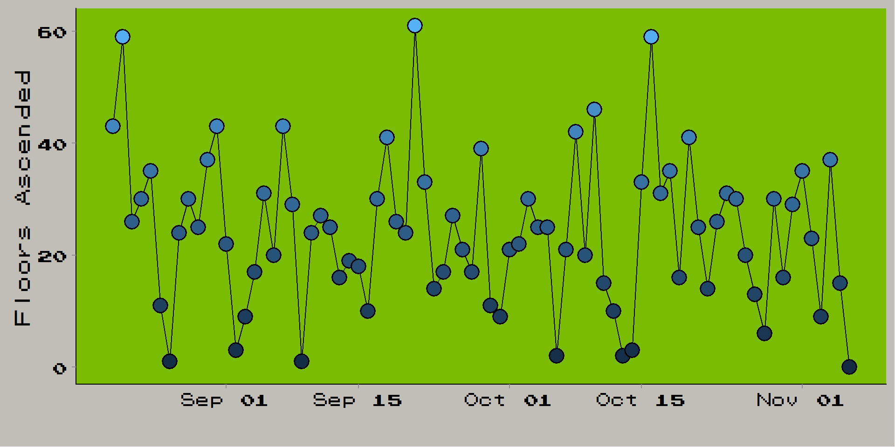

```
g + theme_gba() + theme(legend.position = "none")
```

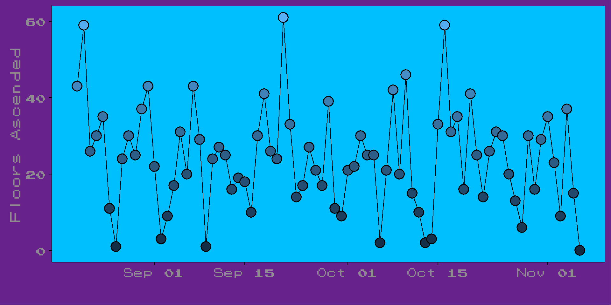

```
# gganimate
g <- activity_df %>%
        ggplot(aes(x=dateTime, y=floors)) +
        geom_line(colour = "black") +
        geom_point(shape = 21, colour = "black", aes(fill = floors), size = 5, stroke = 1) +
        transition_time(dateTime) +
        shadow_mark() +
        ease_aes('linear') +
        xlab("") +
        ylab("Floors Ascended")

g + theme_gameboy() + theme(legend.position = "none")
g + theme_gba() + theme(legend.position = "none")
```


## Closing thoughts

* * *

Even though Fitbit offers a nice dashboard for a single user it’s not scale-able. By accessing the data directly one can ask the questions they want from 200 individuals - or more. If one was inclined, they could even build a fancy `Shiny` dashboard with bespoke visualizations.

If you have any questions or comments you can always reach me on [LinkedIn](https://www.linkedin.com/in/matthewoldach/). Till then, see you in the next post!

```
# Wubba Lubba Dub Dub

# https://www.spriters-resource.com/game_boy_advance/kirbynim/sheet/15585/
sprite_sheet <- png::readPNG("kirby.png")

Nframes       <- 11      # number of frames to extract
width         <- 29      # width of a frame
sprite_frames <- list()  # storage for the extracted frames

# Not equal sized frames in the sprite sheet. Need to compensate for each frame
offset <- c(0, -4, -6, -7, -10, -16, -22, -26, -28, -29, -30)

# Manually extract each frame
for (i in seq(Nframes)) {
  sprite_frames[[i]] <- sprite_sheet[120:148, (width*(i-1)) + (1:width) + offset[i], 1:3]
}

# Function to convert a sprite frame to a data.frame
# and remove any background pixels i.e. #00DBFF
sprite_frame_to_df <- function(frame) {
  plot_df <- data_frame(
    fill  = as.vector(as.raster(frame)),
    x = rep(1:width, width),
    y = rep(width:1, each=width)
  ) %>%
    filter(fill != '#00DBFF')
}

sprite_dfs <- sprite_frames %>%
  map(sprite_frame_to_df) %>%
  imap(~mutate(.x, idx=.y))

fill_manual_values <- unique(sprite_dfs[[1]]$fill)
fill_manual_values <- setNames(fill_manual_values, fill_manual_values)

mega_df <- dplyr::bind_rows(sprite_dfs)

p <- ggplot(mega_df, aes(x, y, fill=fill)) +
  geom_tile(width=0.9, height=0.9) +
  coord_equal(xlim=c(1, width), ylim=c(1, width)) +
  scale_fill_manual(values = fill_manual_values) +
  theme_gba() +
        xlab("") +
        ylab("") +
  theme(legend.position = 'none', axis.text=element_blank(), axis.ticks = element_blank())

panim <- p +
  transition_manual(idx, seq_along(sprite_frames)) +
  labs(title = "gganimate Kirby")

gganimate::animate(panim, fps=30, width=400, height=400)
```

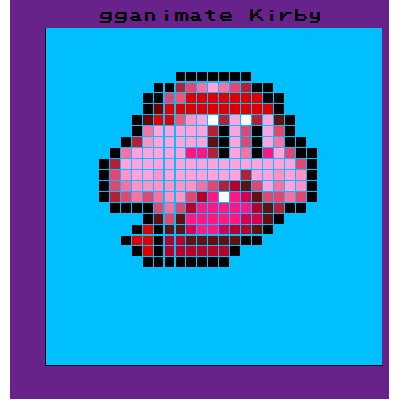

```
sessionInfo()
```

```
## R version 3.5.1 (2018-07-02)
## Platform: x86_64-w64-mingw32/x64 (64-bit)
## Running under: Windows 10 x64 (build 17134)
##
## Matrix products: default
##
## locale:
## [1] LC_COLLATE=English_Canada.1252  LC_CTYPE=English_Canada.1252
## [3] LC_MONETARY=English_Canada.1252 LC_NUMERIC=C
## [5] LC_TIME=English_Canada.1252
##
## attached base packages:
## [1] stats     graphics  grDevices utils     datasets  methods   base
##
## other attached packages:
##  [1] bindrcpp_0.2.2       fitbitr_0.1.0        Rokemon_0.0.1
##  [4] gganimate_0.9.9.9999 cowplot_0.9.3        corrplot_0.84
##  [7] kableExtra_0.9.0     ggcorrplot_0.1.2     ggExtra_0.8
## [10] httr_1.3.1           ggridges_0.5.1       magrittr_1.5
## [13] forcats_0.3.0        stringr_1.3.1        dplyr_0.7.6
## [16] purrr_0.2.5          readr_1.1.1          tidyr_0.8.1
## [19] tibble_1.4.2         ggplot2_3.0.0        tidyverse_1.2.1
## [22] needs_0.0.3
##
## loaded via a namespace (and not attached):
##  [1] nlme_3.1-137      sf_0.7-0          lubridate_1.7.4
##  [4] progress_1.2.0    rprojroot_1.3-2   tools_3.5.1
##  [7] backports_1.1.2   utf8_1.1.4        R6_2.3.0
## [10] spData_0.2.9.4    DBI_1.0.0         lazyeval_0.2.1
## [13] colorspace_1.3-2  withr_2.1.2       tidyselect_0.2.5
## [16] prettyunits_1.0.2 curl_3.2          compiler_3.5.1
## [19] extrafontdb_1.0   cli_1.0.1         rvest_0.3.2
## [22] xml2_1.2.0        labeling_0.3      scales_1.0.0
## [25] classInt_0.2-3    digest_0.6.18     rmarkdown_1.10
## [28] pkgconfig_2.0.2   htmltools_0.3.6   extrafont_0.17
## [31] highr_0.7         htmlwidgets_1.3   rlang_0.3.0
## [34] readxl_1.1.0      rstudioapi_0.8    shiny_1.1.0
## [37] bindr_0.1.1       farver_1.0        jsonlite_1.5
## [40] Rcpp_0.12.19      munsell_0.5.0     fansi_0.4.0
## [43] stringi_1.2.4     yaml_2.2.0        plyr_1.8.4
## [46] grid_3.5.1        promises_1.0.1    crayon_1.3.4
## [49] miniUI_0.1.1.1    lattice_0.20-35   haven_1.1.2
## [52] hms_0.4.2         transformr_0.1.0  knitr_1.20
## [55] pillar_1.3.0      reshape2_1.4.3    lpSolve_5.6.13
## [58] glue_1.3.0        evaluate_0.12     gifski_0.8.6
## [61] modelr_0.1.2      png_0.1-7         tweenr_0.1.5.9999
## [64] httpuv_1.4.5      Rttf2pt1_1.3.7    cellranger_1.1.0
## [67] gtable_0.2.0      assertthat_0.2.0  mime_0.6
## [70] xtable_1.8-3      broom_0.5.0       e1071_1.7-0
## [73] later_0.7.5       class_7.3-14      viridisLite_0.3.0
## [76] units_0.6-1
```


* * *

A work by [Matthew J. Oldach](https://github.com/moldach/)

_moldach686@gmail.com_

[](https://twitter.com/MattOldach)[](https://www.linkedin.com/in/matthewoldach/)[](https://github.com/moldach/)
