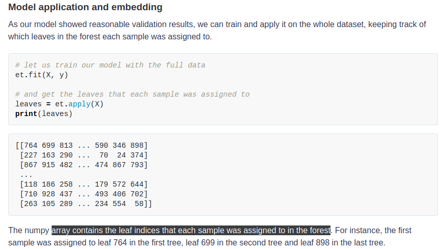
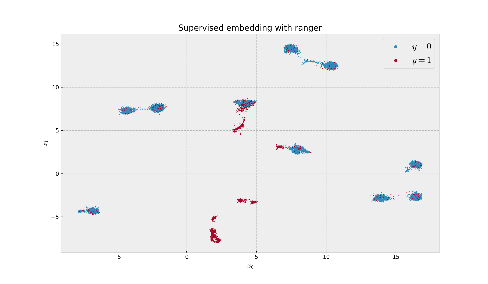
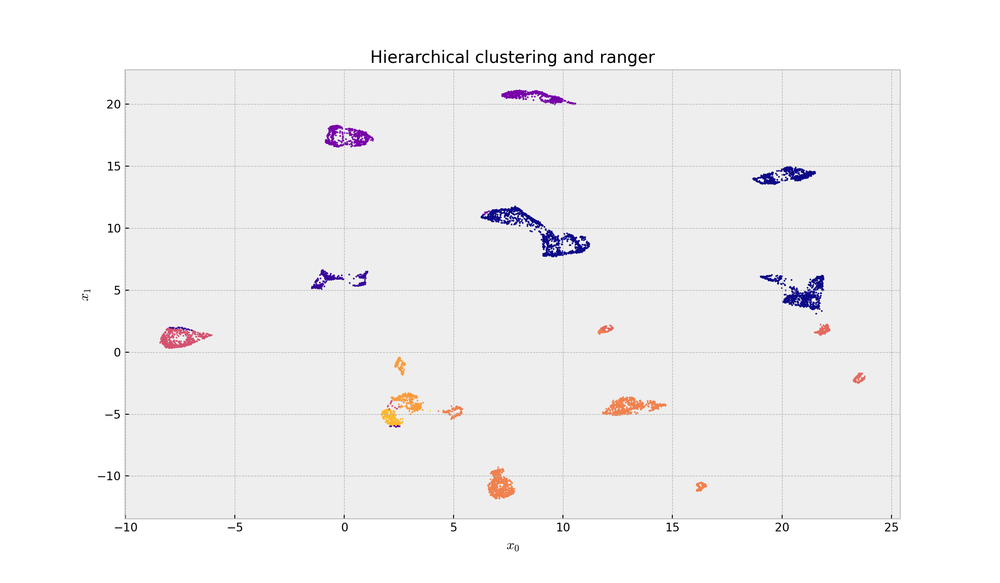

[](https://moldach.github.io/)


## Project Overview

I’ve transcompiled code from `Python` (code shown in red) to `R`(code shown in blue) in order to do supervised dimensionality reduction with **Random Forests (RF)** and **UMAP** following [this blog post](https://gdmarmerola.github.io/umap-supervised-embeddings/).

The goal was to get an array that contains the leaf indices that each sample was assigned to in the forest in order to feed this information into {[`uwot`](https://github.com/jlmelville/uwot)} (for `UMAP` implementation in `R`).

I tried out the following `R` packages, {[randomForest](https://cran.r-project.org/web/packages/randomForest/randomForest.pdf)}, {[ranger](https://www.google.com/url?sa=t&rct=j&q=&esrc=s&source=web&cd=2&cad=rja&uact=8&ved=2ahUKEwjapMyWwLrmAhXsna0KHbu-C2AQFjABegQIARAC&url=https%3A%2F%2Fcran.r-project.org%2Fweb%2Fpackages%2Franger%2Franger.pdf&usg=AOvVaw2g1hScSosIQ5EIH2VCfWZo)}, and {[extraTrees](https://cran.r-project.org/web/packages/extraTrees/extraTrees.pdf)}. {`ranger`} was expected to require the lowest compute-time (critical for my project) while {`extraTrees`}, in some-cases, can outperform RF implementations (in terms of **AUC**). \_Note: For this project, we are providing a `Java` facing UI to clinicians who are **Subject Matter Experts** who have background knowledge in the underlying biology of an analysis but lack the computational expertise for such analysis. _Also note, we are limited to `1 core` on the Java server we provide for analysis; so, necessarily we will benchmark tools in `serial` below_.

In `Python`, `scikit-learn` the `ExtraTreesClassifier` returns a `numpy` array which contains the leaf indices that each sample was assigned to in the forest like so:



To make it as comparable as-possible between `R`/`Python` we will do the brunt of the work using `Python` using {`reticulate`} following instructions from the blog (however, here, we are decreasing the size of simulated data) comparing only the various **RF** implementations.

* * *

## Setting up the `Python` environment

```
reticulate::conda_create('r-reticulate', python_version = 3.6)
PYTHON_DEPENDENCIES = c('pandas',
                        'numpy',
                        'numba',
                        'scipy',
                        'matplotlib',
                        'scikit-learn',
                        'umap-learn',
                        'tqdm',
                        'pynndescent',
                        'fastcluster'
                        )
reticulate::conda_install('r-reticulate', packages = PYTHON_DEPENDENCIES, ignore_installed=TRUE)
```

* * *

### Python Implementation

```
import numpy as np
import pandas as pd
import scipy as sp
import matplotlib.pyplot as plt
from sklearn.ensemble import RandomForestClassifier, ExtraTreesClassifier
from sklearn.preprocessing import OneHotEncoder, StandardScaler
from sklearn.model_selection import cross_val_predict, StratifiedKFold
from sklearn.metrics import roc_auc_score
from sklearn.datasets import make_classification
from tqdm import tqdm
from umap import UMAP  ## if this doesn't work try: import umap.umap_ as UMAP
from pynndescent import NNDescent
from fastcluster import single
from scipy.cluster.hierarchy import cut_tree, fcluster, dendrogram
from scipy.spatial.distance import squareform
from sklearn.tree import DecisionTreeClassifier, ExtraTreeClassifier
from sklearn.model_selection import train_test_split

# turning off automatic plot showing, and setting style
plt.style.use('bmh')

# let us generate some data with 10 clusters per class
X, y = make_classification(n_samples=10000, n_features=500, n_informative=5,
                           n_redundant=0, n_clusters_per_class=10, weights=[0.80],
                           flip_y=0.05, class_sep=3.5, random_state=42)

# normalizing to eliminate scaling differences
X = pd.DataFrame(StandardScaler().fit_transform(X))

# Split dataset into training set and test set
X_train, X_test, y_train, y_test = train_test_split(X, y, test_size=0.3, random_state=42) # 70% training and 30% test
```

Let’s use `Python`’s `ExtraTreesClassifier` to get the information from leaf indices and plot.

In the [blog post](https://gdmarmerola.github.io/umap-supervised-embeddings/) the author used `StratifiedKFold` & `cross_val_predict`. Here I use `train_test_split` instead to create a **train/test** split. This way I can use the same **train/split** for `Python` & `R` and ensure the **Area under the ROC curve** measurement is comparable.

```
# model instance
et = ExtraTreesClassifier(n_estimators=100, min_samples_leaf=500, max_features=0.80, bootstrap=True, class_weight='balanced', n_jobs=-1, random_state=42)

# Train ExtraTreesClassifer
et.fit(X_train, y_train)

# Print the AUC
```

```
## ExtraTreesClassifier(bootstrap=True, class_weight='balanced', max_features=0.8,
##                      min_samples_leaf=500, n_jobs=-1, random_state=42)
```

```
print('Area under the ROC Curve:', roc_auc_score(y_test, et.predict_proba(X_test)[:,1]))
```

```
## Area under the ROC Curve: 0.850375887423935
```

The models performance is **0.8504 AUC**. Now we move on to embedding.

```
# let us train our model with the full data
et.fit(X, y)

# and get the leaves that each sample was assigned to
```

```
## ExtraTreesClassifier(bootstrap=True, class_weight='balanced', max_features=0.8,
##                      min_samples_leaf=500, n_jobs=-1, random_state=42)
```

```
leaves = et.apply(X)
```

What are dimensions of the `numpy` array?

```
leaves.shape
```

```
## (10000, 100)
```

```
# calculating the embedding with hamming distance
sup_embed_et = UMAP(metric='hamming').fit_transform(leaves)

# plotting the embedding
```

```
## /home/mtg/miniconda3/envs/r-reticulate/lib/python3.6/site-packages/umap/umap_.py:1762: UserWarning: gradient function is not yet implemented for hamming distance metric; inverse_transform will be unavailable
##   "inverse_transform will be unavailable".format(self.metric)
```

```
plt.figure(figsize=(12,7), dpi=150)
```

```
plt.scatter(sup_embed_et[y == 0,0], sup_embed_et[y == 0,1], s=1, c='C0', cmap='viridis', label='$y=0$')
```

```
## <matplotlib.collections.PathCollection object at 0x7f1b12fefc50>
```

```
plt.scatter(sup_embed_et[y == 1,0], sup_embed_et[y == 1,1], s=1, c='C1', cmap='viridis', label='$y=1$')
```

```
## <matplotlib.collections.PathCollection object at 0x7f1b12d247f0>
```

```
plt.title('Supervised embedding with ExtraTrees')
```

```
## Text(0.5, 1.0, 'Supervised embedding with ExtraTrees')
```

```
plt.xlabel('$x_0$'); plt.ylabel('$x_1$')
```

```
## Text(0.5, 0, '$x_0$')
## Text(0, 0.5, '$x_1$')
```

```
plt.legend(fontsize=16, markerscale=5);
plt.show()
```



```
# taking a sample of the dataframe
embed_sample = pd.DataFrame(sup_embed_et).sample(5000, random_state=42)

# running fastcluster hierarchical clustering on the improved embedding
H = single(embed_sample)

# getting the clusters
clusters = cut_tree(H, height=0.35)
print('Number of clusters:', len(np.unique(clusters)))
```

```
## Number of clusters: 19
```

This shows 19 clusters (the simulated number was 20).

```
# creating a dataframe for the clustering sample
clust_sample_df = pd.DataFrame({'cluster': clusters.reshape(-1), 'cl_sample':range(len(clusters))})

# creating an index with the sample used for clustering
index = NNDescent(embed_sample, n_neighbors=10)

# querying for all the data
nn = index.query(sup_embed_et, k=1)

# creating a dataframe with nearest neighbors for all samples
to_cluster_df = pd.DataFrame({'sample':range(sup_embed_et.shape[0]), 'cl_sample': nn[0].reshape(-1)})

# merging to assign cluster to all other samples, and tidying it
final_cluster_df = to_cluster_df.merge(clust_sample_df, on='cl_sample')
final_cluster_df = final_cluster_df.set_index('sample').sort_index()

# plotting the embedding
plt.figure(figsize=(12,7), dpi=150)
```

```
plt.scatter(sup_embed_et[:,0], sup_embed_et[:,1], s=1, c=final_cluster_df['cluster'], cmap='plasma')
```

```
## <matplotlib.collections.PathCollection object at 0x7f1b40c6ee48>
```

```
plt.title('Hierarchical clustering and extraTrees')
```

```
## Text(0.5, 1.0, 'Hierarchical clustering and extraTrees')
```

```
plt.xlabel('$x_0$'); plt.ylabel('$x_1$')
```

```
## Text(0.5, 0, '$x_0$')
## Text(0, 0.5, '$x_1$')
```

```
plt.show()
```



* * *

### R Implementation(s)

Now, in R create a `data.frame` using the same data we simulated with Python and split into **train/test** with `sklearn`’s `train_test_split`:

```
library(dplyr)
```

```
##
## Attaching package: 'dplyr'
```

```
## The following objects are masked from 'package:stats':
##
##     filter, lag
```

```
## The following objects are masked from 'package:base':
##
##     intersect, setdiff, setequal, union
```

```
library(reticulate)

df <- data.frame(py$X)
df$labels <- as.factor(py$y) # convert to factor for classification

d_train <- data.frame(py$X_train)
d_test <- data.frame(py$X_test)
d_train$labels <- py$y_train
d_test$labels <- py$y_test

# Identity the response column
ycol <- "labels"

# Identify the predictor columns
xcols <- setdiff(names(d_train), ycol)

# Convert response to factor (required by randomForest)
d_train[,ycol] <- as.factor(d_train[,ycol])
d_test[,ycol] <- as.factor(d_test[,ycol])
```

#### `randomForest`

First, the {`randomForest`} package (one of the oldest, most well-known, but not most-optimal, packages):

```
library(randomForest)
```

```
## randomForest 4.6-14
```

```
## Type rfNews() to see new features/changes/bug fixes.
```

```
##
## Attaching package: 'randomForest'
```

```
## The following object is masked from 'package:dplyr':
##
##     combine
```

```
library(cvAUC)
```

```
## Loading required package: ROCR
```

```
## Loading required package: data.table
```

```
##
## Attaching package: 'data.table'
```

```
## The following objects are masked from 'package:dplyr':
##
##     between, first, last
```

```
##
```

```
## cvAUC version: 1.1.0
```

```
## Notice to cvAUC users: Major speed improvements in version 1.1.0
```

```
##
```

```
# Train a default RF model with 100 trees
## set
set.seed(123)  # For reproducibility
system.time(
  model <- randomForest(
    x = d_train[,xcols],
    y = d_train[,ycol],
    xtest = d_test[,xcols],
    ntree = 100,
    nodes = TRUE # set to keep information on which trees in forest assigned to
    )
  )  ## user: 30.835 system: 0.008 elapsed: 30.837
```

```
##    user  system elapsed
##  40.846   0.041  40.932
```

```
# Generate predictions on test dataset
preds <- model$test$votes[, 2]
labels <- d_test[,ycol]

# Compute AUC on the test set
cvAUC::AUC(predictions = preds, labels = labels)
```

```
## [1] 0.8918756
```

The model performance is **0.8919** AUC. This is slightly better than what we saw in Python (albeit a _bit_ slower)

Now, as we did in `Python`, we need to train and apply it on the whole dataset, keeping track of which leaves in the forest each sample was assigned to.

```
set.seed(123)  # For reproducibility
md_full <- randomForest(formula = labels ~ ., data = df, ntree = 100, keep.forest = TRUE)
phat_full <- predict(md_full, newdata = df, type = "prob", nodes = TRUE)

# get the leaf indices that each sample was assigned to in the forest
leaves <- attr(phat_full, "nodes")
dim(leaves)
```

```
## [1] 10000   100
```

For consistency, let’s take the data back into Python and plot it using `matplotlib`:

```
# Assign R object as Python object
leafs = r.leaves
# Get embeddings from UMAP
sup_embed_rf = UMAP(metric='hamming').fit_transform(leafs)

# plotting the embedding
```

```
## /home/mtg/miniconda3/envs/r-reticulate/lib/python3.6/site-packages/umap/umap_.py:1762: UserWarning: gradient function is not yet implemented for hamming distance metric; inverse_transform will be unavailable
##   "inverse_transform will be unavailable".format(self.metric)
```

```
plt.figure(figsize=(12,7), dpi=150)
```

```
plt.scatter(sup_embed_rf[y == 0,0], sup_embed_rf[y == 0,1], s=1, c='C0', cmap='viridis', label='$y=0$')
```

```
## <matplotlib.collections.PathCollection object at 0x7f1af0bdd278>
```

```
plt.scatter(sup_embed_rf[y == 1,0], sup_embed_rf[y == 1,1], s=1, c='C1', cmap='viridis', label='$y=1$')
```

```
## <matplotlib.collections.PathCollection object at 0x7f1b4091ce10>
```

```
plt.title('Supervised embedding with randomForest')
```

```
## Text(0.5, 1.0, 'Supervised embedding with randomForest')
```

```
plt.xlabel('$x_0$'); plt.ylabel('$x_1$')
```

```
## Text(0.5, 0, '$x_0$')
## Text(0, 0.5, '$x_1$')
```

```
plt.legend(fontsize=16, markerscale=5);
plt.show()

# taking a sample of the dataframe
```


```
embed_sample = pd.DataFrame(sup_embed_rf).sample(5000, random_state=42)

# running fastcluster hierarchical clustering on the improved embedding
H = single(embed_sample)

# getting the clusters
clusters = cut_tree(H, height=0.35)
print('Number of clusters:', len(np.unique(clusters)))
```

```
## Number of clusters: 14
```

This shows 12 clusters (although the simulated number was 20).

```
# creating a dataframe for the clustering sample
clust_sample_df = pd.DataFrame({'cluster': clusters.reshape(-1), 'cl_sample':range(len(clusters))})

# creating an index with the sample used for clustering
index = NNDescent(embed_sample, n_neighbors=10)

# querying for all the data
nn = index.query(sup_embed_et, k=1)

# creating a dataframe with nearest neighbors for all samples
to_cluster_df = pd.DataFrame({'sample':range(sup_embed_et.shape[0]), 'cl_sample': nn[0].reshape(-1)})

# merging to assign cluster to all other samples, and tidying it
final_cluster_df = to_cluster_df.merge(clust_sample_df, on='cl_sample')
final_cluster_df = final_cluster_df.set_index('sample').sort_index()

# plotting the embedding
plt.figure(figsize=(12,7), dpi=150)
```

```
plt.scatter(sup_embed_et[:,0], sup_embed_et[:,1], s=1, c=final_cluster_df['cluster'], cmap='plasma')
```

```
## <matplotlib.collections.PathCollection object at 0x7f1b40c0d358>
```

```
plt.title('Hierarchical clustering and randomForest')
```

```
## Text(0.5, 1.0, 'Hierarchical clustering and randomForest')
```

```
plt.xlabel('$x_0$'); plt.ylabel('$x_1$')
```

```
## Text(0.5, 0, '$x_0$')
## Text(0, 0.5, '$x_1$')
```

```
plt.show()
```


Other `R` packages are known to outperform {`randomForest`} - both in terms of accuracy and speed - so I would also like to get this information from {`ranger`} and {`ExtraTrees`}. `ranger` for example, has excellent speed and support for high-dimensional or wide data (_e.g._ scRNA-sequencing data)

#### `ranger`

Here’s what I’ve got so far with the `ranger` method:

```
library(ranger)
```

```
##
## Attaching package: 'ranger'
```

```
## The following object is masked from 'package:randomForest':
##
##     importance
```

```
library(pROC)
```

```
## Type 'citation("pROC")' for a citation.
```

```
##
## Attaching package: 'pROC'
```

```
## The following objects are masked from 'package:stats':
##
##     cov, smooth, var
```

```
set.seed(123)

# ranger speed
system.time(
  df_ranger <- ranger(
    formula = labels ~ .,
    data = d_train,
    num.trees = 100,
    num.threads = 1, # default is the number of CPUs on machine
    probability = TRUE
  )
) # user 13.047 system: 0.01 elapsed: 13.048
```

```
##    user  system elapsed
##  17.647   0.006  17.672
```

```
pred.ranger <- predict(df_ranger, data = d_test, type = "terminalNodes")
# get model accuracy
ranger.roc <- roc(d_test$labels, pred.ranger$predictions[,2])
```

```
## Setting levels: control = 0, case = 1
```

```
## Setting direction: controls > cases
```

```
pROC::auc(ranger.roc)
```

```
## Area under the curve: 0.5741
```

This model didn’t perform SO well with **0.5471 AUC**. DO YOU THINK THIS COULD BE DUE TO `pROC` WHAT IT IS RECORD??

```
set.seed(123)
df_ranger <- ranger(formula = labels ~ ., data = df, num.trees = 100, probability = TRUE)

pred.ranger <- predict(df_ranger, data = df, type = "terminalNodes")
lyves <- pred.ranger$predictions
```

Now in enter `repl_python()` and in Python enter:

```
# Assign R object as Python object
lyves = r.lyves
# Get embeddings from UMAP
sup_embed_rg = UMAP(metric='hamming').fit_transform(lyves)

# plotting the embedding
```

```
## /home/mtg/miniconda3/envs/r-reticulate/lib/python3.6/site-packages/umap/umap_.py:1762: UserWarning: gradient function is not yet implemented for hamming distance metric; inverse_transform will be unavailable
##   "inverse_transform will be unavailable".format(self.metric)
```

```
plt.figure(figsize=(12,7), dpi=150)
```

```
plt.scatter(sup_embed_rg[y == 0,0], sup_embed_rg[y == 0,1], s=1, c='C0', cmap='viridis', label='$y=0$')
```

```
## <matplotlib.collections.PathCollection object at 0x7f1b12d8b5f8>
```

```
plt.scatter(sup_embed_rg[y == 1,0], sup_embed_rg[y == 1,1], s=1, c='C1', cmap='viridis', label='$y=1$')
```

```
## <matplotlib.collections.PathCollection object at 0x7f1af87baba8>
```

```
plt.title('Supervised embedding with ranger')
```

```
## Text(0.5, 1.0, 'Supervised embedding with ranger')
```

```
plt.xlabel('$x_0$'); plt.ylabel('$x_1$')
```

```
## Text(0.5, 0, '$x_0$')
## Text(0, 0.5, '$x_1$')
```

```
plt.legend(fontsize=16, markerscale=5);
plt.show()

# taking a sample of the dataframe
```


```
embed_sample = pd.DataFrame(sup_embed_rg).sample(5000, random_state=42)

# running fastcluster hierarchical clustering on the improved embedding
H = single(embed_sample)

# getting the clusters
clusters = cut_tree(H, height=0.35)
print('Number of clusters:', len(np.unique(clusters)))
```

```
## Number of clusters: 17
```

This shows 14 clusters (although the simulated number was 20).

```
# creating a dataframe for the clustering sample
clust_sample_df = pd.DataFrame({'cluster': clusters.reshape(-1), 'cl_sample':range(len(clusters))})

# creating an index with the sample used for clustering
index = NNDescent(embed_sample, n_neighbors=10)

# querying for all the data
nn = index.query(sup_embed_et, k=1)

# creating a dataframe with nearest neighbors for all samples
to_cluster_df = pd.DataFrame({'sample':range(sup_embed_et.shape[0]), 'cl_sample': nn[0].reshape(-1)})

# merging to assign cluster to all other samples, and tidying it
final_cluster_df = to_cluster_df.merge(clust_sample_df, on='cl_sample')
final_cluster_df = final_cluster_df.set_index('sample').sort_index()

# plotting the embedding
plt.figure(figsize=(12,7), dpi=150)
```

```
plt.scatter(sup_embed_et[:,0], sup_embed_et[:,1], s=1, c=final_cluster_df['cluster'], cmap='plasma')
```

```
## <matplotlib.collections.PathCollection object at 0x7f1aee1ad588>
```

```
plt.title('Hierarchical clustering and ranger')
```

```
## Text(0.5, 1.0, 'Hierarchical clustering and ranger')
```

```
plt.xlabel('$x_0$'); plt.ylabel('$x_1$')
```

```
## Text(0.5, 0, '$x_0$')
## Text(0, 0.5, '$x_1$')
```

```
plt.show()
```


#### `extraTrees`

The {`extraTrees`} package, may achieve the closest comparison to `scikit-learn`’s `ExtraTreesClassifier` function.

```
library(extraTrees)
```

```
## Loading required package: rJava
```

```
y <- "labels"
characteristics <- setdiff(names(d_train), y)
train <- d_train[, characteristics]
test <- d_test[, characteristics]
set.seed(123)

system.time({
model_extraTrees <- extraTrees(x = train,
                               y = as.factor(d_train$labels),
                               ntree = 500,
                               numThreads = 1 # must be set explicitly as the default is 1
                               )
}) # user 10.184 system: 0.104 elapsed: 9.770
```

```
##    user  system elapsed
##  14.276   0.146  13.468
```

However, unlike it’s `Python` counterpart, at this time one cannot get the lead indices from {`extraTrees`} so I made a [feature request](https://github.com/jaak-s/extraTrees/issues/10#issuecomment-568298800).

If you find this article useful feel free to share it with others or recommend this article! 😄

As always, if you have any questions or comments feel free to leave your feedback below or you can always reach me on [LinkedIn](https://www.linkedin.com/in/matthewoldach/). Till then, see you in the next post! 🙇‍♀
